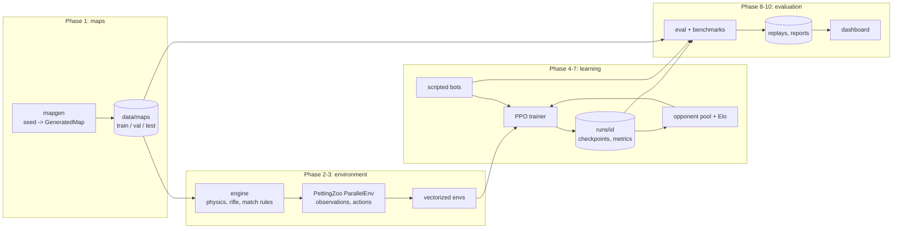

# RL-Donut — Project Plan and Technical Design

This is the one place that describes the whole project: what we are building, in what
order, how the pieces fit together, what runs where, and which decisions are made or still
open. It is a living document; update it whenever a phase lands or a plan changes.

| Document | Role |
|---|---|
| `docs/PLAN.md` (this file) | The whole project: goals, roadmap, architecture, infrastructure, open decisions |
| [`DESIGN.md`](../DESIGN.md) | Decision log: every approved choice, numbered, with its reason |
| [`docs/mapgen.md`](mapgen.md) | Deep dive into the map generator (Phase 1), step by step |
| [`docs/engine.md`](engine.md) | Deep dive into the game engine (Phase 2), step by step |
| [`docs/handoff_phase5_6.md`](handoff_phase5_6.md) | Guide for the teammate building Phases 5–6 in parallel: interface contract, steps, merge checklist |
| [`docs/SUBMISSION.md`](SUBMISSION.md) | Notes for evaluators: setup, which result to grade, and what is still open |
| [`docs/PROGRESS.md`](PROGRESS.md) | What is finished, the training measurements, and what is left |
| [`docs/REPORT.md`](REPORT.md) | Earlier sign-off. The current result is in `PROGRESS.md` |
| [`README.md`](../README.md) | Setup, everyday commands, repository layout |

Status markers used below: **approved** (in `DESIGN.md`, may be built), **draft** (a
starting proposal; must be discussed and approved before code), **open** (no proposal yet).

---

## 1. Goal

Build a Mini Militia-inspired 2D arena in which reinforcement-learning agents with jetpacks
and rifles learn to fight through PPO and self-play on procedurally generated cave maps,
and show that what they learn **carries over to maps they have never seen**. The project
follows the EvoArena brief's 12 milestones:

| # | Milestone | Phase |
|---|---|---|
| 1 | Gaming environment design | 2 |
| 2 | Procedural map generation | 1 |
| 3 | Agent observation and action spaces | 3 |
| 4 | Reward function design | 5 |
| 5 | PPO implementation | 5 |
| 6 | Multi-agent reinforcement learning | 6 |
| 7 | Self-play training framework | 6 |
| 8 | Multi-agent cooperation and competition | 6 |
| 9 | Adaptive opponent training | 7 |
| 10 | Unseen environment generalization | 8 |
| 11 | Interactive training dashboard | 9 |
| 12 | Performance benchmarking and evaluation | 10 |

**Approved high-level choices:** 2D side view (G1), structured observations rather than
pixels (G1), health regeneration on (G2), final format 1v1 and/or 2v2 decided later (G3).

## 2. How we work

Every step follows the same loop:

1. **Discuss.** For any decision that affects the project: why we need it, the
   alternatives, facts checked against sources or measurements, and what to learn about it.
2. **Approve.** Nothing is coded until the choice is approved.
3. **Build.** Code, tests and a picture or measurement wherever it helps.
4. **Review.** We look at the output together.
5. **Commit.** One commit per step; the docs are updated in the same commit.

Approved decisions are logged in `DESIGN.md` with an ID (`G` game, `E` environment and
tooling, `M` map generator; later phases add their own letters).

## 3. Status

| Phase | Scope | Milestones | Status |
|---|---|---|---|
| 0 | Project setup | — | done |
| 1 | Seeded procedural map generator | 2 | done (steps 1–9) |
| 2 | Game engine: physics, jetpack, rifle, regen, respawns | 1 | done (steps 1–8) |
| 3 | RL interface: observations, actions, PettingZoo wrapper, speed benchmark | 3 | done (steps 1–8) |
| 4 | Scripted bots, renderer, replay files | — | done (steps 1–8) |
| 5 | Rewards, single-agent PPO against bots | 4, 5 | code on main; spawn-distance training partial |
| 6 | Self-play, opponent pool, Elo, 1v1 then 2v2 | 6, 7, 8 | code on main; no official-spawn result |
| 7 | Adaptive opponents, style policies | 9 | code on main; no official-spawn result |
| 8 | Generalization evaluation (held-out and OOD maps) | 10 | code on main; no official-spawn result |
| 9 | Dashboard | 11 | code on main; reads `runs/` |
| 10 | Benchmarks and final report | 12 | earlier draft in `docs/REPORT.md`; current numbers are in `docs/PROGRESS.md` |

Phases 5–10 are not approved as finished. The code is on `main`. The latest training run is
`runs/spawn-curriculum-14`: 8 of 16 wins at 6–12 tiles with the enemy in sight, then 4 of 16
at 12–16 tiles. The official spawns, which hide the teams, were not trained. Aim is now capped
at 6 degrees and a hidden agent roams the map's floors; those two changes came after that run,
so the checkpoints do not include them.

---

## 4. Architecture

### Data flow

### Packages

| Package | Phase | Responsibility | Status |
|---|---|---|---|
| `rl_donut.mapgen` | 1 | Seed -> validated map; splits and cache | built |
| `rl_donut.env` | 2–4 | Engine (pure numpy, many matches per batch, no rendering), PettingZoo wrapper, bots, renderer, replays | in progress |
| `rl_donut.rl` | 5–7 | PPO, opponent pool, Elo, style policies | planned |
| `rl_donut.eval` | 8, 10 | Generalization tests, benchmark suite, statistics | planned |
| `dashboard/` | 9 | Interactive app reading runs and replays | planned |

Rules that keep the pieces independent:

- The engine never imports rendering code; rendering reads engine state.
- Training reads maps only through `load_split`, never by regenerating them.
- Anything shown in the dashboard is read from files (`runs/`, replays), so it works
  offline and can be built before training exists.

### Contracts between phases

| Contract | Defined by | Used by | Status |
|---|---|---|---|
| `GeneratedMap` (grid, spawns, pits, kill line, metadata) | Phase 1 | engine | approved, built |
| `MapConfig.climb_budget = 12`: the engine must climb at least 12 tiles on one tank | M26 | engine test | approved |
| Fastest motion < 1 tile per tick, so 1-tile walls can't be skipped | M16 | engine test | approved |
| Hitscan uses `mapgen.geometry.line_of_sight`, so "can't see" = "can't be shot" | M40 | engine | approved |
| Scripted bot reaches ≥ 99% of random route targets | M4b | engine test | approved, passes (99.80%, P14) |
| Env API: batched `MatchEnv` (`reset()`, `step(discrete, continuous)`, `get_state()`, spec 0.3) for training; PettingZoo `ParallelEnv` over one match for outside tools | I12–I19 | RL, replays | approved, built |
| Replay file `.json.gz`: `{seed, config, map, ticks: [{agents, shots, events}]}` | — | dashboard | draft |
| Metrics: `runs/<id>/metrics.jsonl` (optionally mirrored to an experiment tracker) | — | dashboard | draft |
| Checkpoint: `runs/<id>/ckpt_<update>.pt` with weights, observation statistics, config, git commit | — | eval, pool | draft |

---

## 5. Technical design by phase

Numbers in **draft** sections are starting points from the first design spec; each is
re-examined, measured where possible, and approved when its phase starts.

### Phase 1 — Map generator (approved, built)

Seeded pipeline: Perlin + FBM noise on the left half, mirrored, quantile-thresholded,
smoothed, bordered; regions joined with staircase tunnels; pits, platforms, spawns;
validation with retry; 10,000 train, 1,000 val and 1,000 test maps cached in `data/maps/`.
Full details in [`docs/mapgen.md`](mapgen.md); decisions M1–M49.

### Phase 2 — Game engine (steps approved, numbers draft)

Steps (approved; listed in `DESIGN.md`): 1 world and state model, 2 tile collision,
3 movement, jetpack and fuel, 4 route check, 5 aiming and hitscan rifle, 6 health, death
and respawn, 7 match loop, 8 debug viewer and speed check. The route check comes before
shooting because a failure there would change the generator and force a rebuild of every map.

| Area | Status | Design |
|---|---|---|
| World | approved (P1–P3, P6) | 96 × 48 tile grid, 1 tile = 1 world unit; many matches per batch; solid outside the map except below the bottom edge |
| Timing | approved (P23, P24) | 30 physics ticks per second; agent decides every 2 ticks (15 decisions/s); 60 s matches |
| Body and collision | approved (P4, P5, P7) | Hitbox 0.8 × 1.6 tiles; one axis at a time against tiles; agents pass through each other |
| Movement | approved (P8–P10) | Run 6 tiles/s (set directly); gravity 25 tiles/s²; thrust 40 tiles/s²; rising limit 12, falling limit 20 tiles/s |
| Fuel | approved (P8) | 100; drains 32/s while thrusting, refills 25/s while standing |
| Rifle | approved (P15–P18) | Hitscan from the hitbox centre, checked with the generator's `line_of_sight`; 15 damage; 0.2 s between shots; uniform ±2° spread; 30-round magazine, 1.5 s auto-reload, unlimited reserve; 30-tile range; no friendly fire; aim at any angle, instantly |
| Health | approved (P19, P20) | 100; regenerates 10/s after 3 s without damage (on, per G2); same-tick hits applied together; death at 0 health or below the kill line |
| Respawn | approved (P21, P22) | 2 s, at a random own spawn no living enemy can see; 1 s protection, ended by firing |
| Match | approved (P24–P26) | Timed deathmatch with respawns; most kills wins, equal is a draw; a pit fall scores for the last enemy to damage the faller within 3 s |
| Out of scope for v1 | draft | Grenades (first v2 addition), pickups, weapon switching, melee, zoom, dual wield |

Required tests, from Phase 1 contracts: climb at least `climb_budget` on one tank; motion
< 1 tile per tick; scripted route check on many seeds; hitscan agrees with line of sight.

Resolved so far: the draft had no rising-speed limit (1.27 tiles per tick, breaking M16)
and left level flight only 2% above the generator's assumption; fixed by P8. Climb and
level-flight contracts pass with 35.7 and 30.0 tiles. The route check passes: 99.80% of
2,000 routes arrive with a full tank before each hop (P12–P14). Hitscan agrees with an
independent check, and no agent on a spawn can hit an agent on an enemy spawn (P15).

Still open:

- How a pit fall is rewarded (G4, Phase 5); the match score already credits the last
  damager within 3 s (P25).
- Gravity and thrust randomization (Phase 3): ±15% on both drops level flight to 22 tiles,
  below the generator's 24. Resolved in Phase 3 step 6 (I17): one factor scales both.

### Phase 3 — RL interface (draft)

- **Actions (approved, I1–I2):** discrete move (left / none / right), jetpack (off / on)
  and shoot (no / yes), plus one continuous aim angle in radians (a Gaussian head in PPO).
  Continuous aim allows 98% of perfectly aimed shots to hit at real engagement distances,
  against 46% for 16 fixed directions.
- **Visibility (approved, I3–I5):** an enemy is seen when its centre or any hitbox corner is
  in line of sight, at any distance; in 2v2 teammates share sightings, with a separate "seen by
  me" flag. Computed for the whole batch by an exact numpy ray caster.
- **Observations (approved, I6–I11): 330 numbers per agent, in the agent's own frame**
  (team B mirrored):
  - self (20): position, velocity, on-ground, fuel, health, ammo, reload, cooldown, aim,
    alive, respawn, protection, direction and age of the last hit;
  - 2 enemy slots (13 each): present, alive, seen by me / by team, remembered, relative
    position (last known when out of sight, forgotten after 10 s), live velocity, health and
    aim only while seen, time since seen;
  - ally slot (9); match (2): time left, score difference;
  - a 21 × 13 tile window around the agent (rock 1, air 0, below the map −1) instead of rays.
- **Memory:** no frame stacking in the environment; the trainer may stack or add an LSTM.
- **Batched env (approved, I12–I15):** `rl_donut.env.MatchEnv` with auto-reset from a
  shuffled map deck, episode stats for the watchlist, and `get_state()` per team for a
  centralized critic.
- **Physics randomization (approved, I17):** one factor per match scales gravity and thrust
  together (level flight stays 30 tiles); off by default, hidden from agents.
- **Speed benchmark (approved, I18):** `scripts/bench_env.py`; 35,000 match steps/s in 1v1
  and 20,400 in 2v2 at 256 matches in one process. No speed-up until Phase 5 shows the env
  is the bottleneck.

### Phase 4 — Bots, renderer, replays (done, [`bots.md`](bots.md))

- **Policy interface (approved, B1):** `rl_donut.env.policy` (`Policy`, `PolicyContext`,
  `play_matches`); random, static, turret and rusher bots in `rl_donut.env.bots`.
- **Perception and yardsticks (approved, B2):** bots shoot only what they can see; the
  rusher chases the true enemy position using cached route plans.
- **Replays and viewer (approved, B3):** `.json.gz` action logs, redrawn by
  `scripts/render_replay.py`.

### Phase 5 — Rewards and PPO (draft)

- **Reward:** sparse (+1 win, −1 loss, 0 draw) + α × shaping (kill +0.3, death −0.3,
  ±0.003 per damage point dealt / taken, −0.0005 per step). α falls from 1.0 to 0.1 over
  the first 60% of training.
- **Exploit watchlist,** logged from the first run: draw rate, engagement distance,
  hovering time, shots per hit, kills near spawns.
- **PPO:** single-file, CleanRL-style implementation (we need custom opponent logic);
  shared MLP 2 × 256 with one head per action part and a separate value network; 64
  environments × 256 steps, 8 minibatches × 4 epochs, learning rate 3e-4 decaying,
  γ 0.99, λ 0.95, clip 0.2, entropy 0.01 → 0.001, value coefficient 0.5, gradient clip 0.5,
  running observation normalization.
- **Curriculum gates:** hit a static target ≥ 90% → beat the turret bot ≥ 70% → beat the
  rusher bot ≥ 60% → self-play → 2v2. Pits start at 0 per map (`PitConfig.count`) and are
  widened to 0–2 as a curriculum step.

### Phase 6 — Self-play (draft)

- Snapshot every 50 updates; it joins the pool only if it beats the previous snapshot
  ≥ 55%. Pool of up to 30 snapshots plus permanent bots and style policies.
- Opponent sampling: 50% latest, 30% pool weighted toward opponents the learner loses to
  (prioritized fictitious self-play), 20% bots and style policies.
- 2v2: parameter sharing with a team ID; a centralized critic (MAPPO) for the 2v2 stage;
  each agent's reward = 0.5 × team + 0.5 × own.
- Reported Elo comes from an offline round-robin (every 10 snapshots, 100 matches per pair,
  sides swapped), not from noisy in-training updates.

### Phase 7 — Adaptive opponents and styles (draft)

- Adaptive opponents: choose pool opponents so the learner's win rate stays around 50–60%.
- Style policies with different reward weights: aggressive (2× damage dealt), defensive
  (2× damage taken penalty), sniper (bonus for long-range kills).

### Phase 8 — Generalization (draft, map side approved)

- Three tiers: train seeds, held-out seeds (`val` for development, `test` once at the end),
  and OOD seeds (30,000+) with shifted settings, e.g. rock 30–35% or 60–65% (M8), wider
  pits, asymmetric maps, gravity and thrust ±25%. OOD splits are defined in this phase (M49).
- Headline number: the **generalization gap**, win rate on train seeds minus win rate on
  unseen seeds, against fixed bots and a frozen checkpoint.

### Phase 9 — Dashboard (draft)

- Elo over generations, win rate against each bot, generalization gap, behaviour stats
  (accuracy, jetpack use, time in cover, engagement distance, teammate spacing), replay
  viewer with seed switching, human-vs-AI play, and a Generation 1 vs Generation N demo.

### Phase 10 — Benchmarks and report (draft)

- 200 matches per pairing on test seeds, sides swapped halfway; win rates with 95% Wilson
  confidence intervals; the main metrics above, collected into a final report.

---

## 6. Technology

| Area | Tool | Status | Why / alternatives |
|---|---|---|---|
| Language | Python 3.13 (3.11+ supported) | approved | RL ecosystem; numpy vectorization for speed |
| Environment | venv + exactly pinned `requirements.txt` | approved (E1) | Zero extra tooling; uv or conda were not needed |
| Numerics | numpy 2.5.4, pinned | approved (M1, M3) | Map reproducibility depends on its random streams |
| Tests | pytest 9.2 | approved | Standard; golden-value and drift tests |
| Charts and previews | matplotlib 3.11, scripts only | approved (E2) | Never imported by library code |
| Deep learning | PyTorch | draft (Phase 5) | Named in the brief; alternative JAX is faster on accelerators but adds friction on a Mac |
| Multi-agent API | PettingZoo 1.27 `ParallelEnv` + Gymnasium 1.4 spaces, for outside tools | approved (I19) | Named in the brief; standard multi-agent interface. Training uses the batched `MatchEnv` |
| Rendering | matplotlib, scripts only (`render_replay.py`) | approved (B3) | Only for viewing; the engine stays headless. Pygame was the alternative and was not needed |
| Experiment tracking | Local `metrics.jsonl`; optionally Weights & Biases or TensorBoard | open (Phase 5) | Local files keep the dashboard offline-capable |
| Dashboard | Streamlit suggested | open (Phase 9) | Fastest to build; alternative FastAPI + a web front end is more flexible but slower to build |

No tool in the draft or open rows is installed until its phase's discussion approves it.

---

## 7. Infrastructure

### Compute

| Resource | Value | Implication |
|---|---|---|
| Machine | Apple M4, 4 performance + 6 efficiency cores, 16 GB memory | CPU-bound simulation; ~8 parallel workers in practice |
| GPU | Integrated M4 GPU (PyTorch "MPS" backend) | For 2 × 256 MLPs, CPU is often as fast; measure in Phase 5 |
| Disk | 26 GB free (94% used) | Checkpoints and replays must be pruned; keep `runs/` lean |
| Background load | Load average often 10–28 from other apps | Benchmarks must report load; timings in docs are on a busy machine |

The draft PPO numbers (64 environments, ≥ 10,000 steps/s) assumed a multi-core desktop
with a GPU. Phase 3's speed benchmark (I18, [`interface.md`](interface.md#step-7--full-environment-speed-benchmark))
measured the full env in one process at 35,000 match steps/s in 1v1 and 20,400 in 2v2
(256 matches, load average about 5). Targets: one process, 256 matches per batch in 1v1 and
128 in 2v2; the env and a PPO update cost about the same per sample, so roughly
15,000–20,000 training samples/s end to end is expected, to be measured in Phase 5.

### Storage layout

| Path | Contents | In git |
|---|---|---|
| `src/`, `tests/`, `scripts/`, `docs/` | Code and documentation | yes |
| `data/maps/` | Frozen train / val / test maps (~14 MB) | yes (M46) |
| `map_cache/` | Resumable build chunks | no |
| `outputs/` | Preview images, charts, logs | no |
| `runs/<id>/` | Checkpoints, metrics, replays per training run | no (selected results may be exported) |

### Reproducibility

- Every random choice comes from a named, seeded stream (M2); retries use attempt numbers.
- numpy is pinned; `GENERATOR_VERSION` is stored with every map; golden tests pin exact outputs.
- Built maps are frozen in git; any output change bumps the version and rebuilds (M47),
  and a drift test catches forgotten bumps.
- Checkpoints will record config and git commit, so every result can be traced to code.

### Version control and CI

- Git, one commit per approved step, pushed to
  [github.com/thekrishmellow/RL-Donut](https://github.com/thekrishmellow/RL-Donut).
- No CI yet. Once a remote exists, run the test suite on every push; the full suite takes
  ~6 minutes on a busy laptop, so slow tests may need a marker.

### Team

Two teams working in parallel. Team A builds Phases 3–4 (RL interface, bots,
renderer, replays); Team B builds Phases 5–6 (rewards, PPO, self-play) on branch
`phase5-6` against a stand-in environment. The two are merged at the end of Phase 4. The
interface between them, the step list and the merge checklist are in
[`docs/handoff_phase5_6.md`](handoff_phase5_6.md).

Status: the learning code is on `main` and steps `MatchEnv` at spec 0.3. A spawn-distance
run has been measured (`runs/spawn-curriculum-14`). Phases 5–10 are still not logged as
approved in `DESIGN.md`. `docs/rl.md` holds decisions made on the stand-in; those stay a
starting point until they are reviewed against the real environment.

---

## 8. Risks

| Risk | Mitigation |
|---|---|
| Engine physics breaks map assumptions (climb, wall thickness) | Phase 2 contract tests fail loudly; generator settings can change with a version bump |
| Environment too slow for PPO on this laptop | Benchmark in Phase 3 before training; batch physics across environments in numpy |
| PPO fails to beat the turret bot | Check observations and rewards via replays first; then simplify (slower bot, shorter range) |
| Self-play cycles between strategies | More matches against old snapshots; detect with offline Elo |
| Reward exploits (camping, spawn camping, spam) | Exploit watchlist from the first run |
| 2v2 not ready | 1v1 still covers multi-agent learning and self-play |
| Disk fills with checkpoints | Keep only pool members and milestones; prune automatically |
| Only one copy of the work | Pushed to GitHub after every step |

## 9. Open decisions

| Decision | When | Notes |
|---|---|---|
| Final format: 1v1, 2v2 or both | Phase 6 | G3 |
| Grenades in v1 or v2 | Phase 2 | Draft says v2 |
| Kill credit for falls | Phase 5 | G4 |
| PyTorch, PettingZoo, renderer, tracker, dashboard tool | Their phases | Section 6 |
| OOD split definitions | Phase 8 | M49 |
| CI (tests on every push) | Any time; before friends join | Section 7 |
