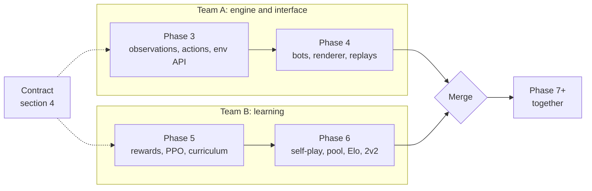

# Handoff: Phases 5–6 (rewards, PPO, self-play)

This guide is for the teammate building **Phase 5 (rewards and PPO against bots)** and
**Phase 6 (self-play, opponent pool, Elo, 1v1 then 2v2)** while the rest of the team
builds Phases 3–4 (RL interface, bots, renderer, replays) on top of the finished engine. The two halves are
**merged at the end of Phase 4**.

It covers what already exists, the working rules, the interface both sides build against,
every planned step with the decisions to make in it, and the merge checklist.

| Read next | Why |
|---|---|
| [`docs/PLAN.md`](PLAN.md) | The whole project: roadmap, architecture, draft designs, open decisions |
| [`DESIGN.md`](../DESIGN.md) | Every approved decision, numbered, with its reason |
| [`docs/engine.md`](engine.md) | The game engine, step by step (physics, collision, rifle) |
| [`docs/mapgen.md`](mapgen.md) | The map generator (what a map guarantees) |

Status markers: **approved** (logged in `DESIGN.md`, may be built), **proposed** (in this
guide, to be confirmed by both of us before code relies on it), **draft** (starting
numbers from the first design spec, re-examined in their step).

---

## 0. Read first: what changed since you branched (`c0e9a56`)

`phase5-6` branched from `c0e9a56`, before engine steps 2.6–2.8 and all of Phase 3.
`main` now has the finished engine and the real RL interface, and the contract moved from
the first draft to **`spec_version` "0.3"**. The real `rl_donut.env.MatchEnv` exists, so the
stand-in is no longer needed. `main` has the spec 0.3 contract test, `tests/test_env_contract.py`;
when you merge `main` into `phase5-6`, take `main`'s version of that file. Results measured
on the stand-in must be re-run on `MatchEnv`.

What changed, and what it means for the files on `phase5-6`:

| Change (decision) | Was (draft) | Now (spec 0.3) | Edit on `phase5-6` |
|---|---|---|---|
| Environment | `rl.stand_in.StandInEnv` | `rl_donut.env.MatchEnv(n_matches, team_size, split, seed, map_filter, cfg, maps)`; short matches via `cfg=EngineConfig(team_size=..., match=MatchConfig(duration=...))` | `runner.py`, `evaluate.py`, scripts: build `MatchEnv`; delete `stand_in.py` (or keep it only as a test fixture) |
| Actions (I1, I2) | one int array, `action_nvec = (3, 2, 16, 2)` | `env.step(discrete, continuous)`: discrete `(M, A, 3)` int with `action_nvec = (3, 2, 2)` (move, jetpack, shoot) and continuous `(M, A, 1)` float, the aim angle in radians | `runner.py`: pass both arrays; rollout buffers store the continuous part as float32 |
| Policy head (I1) | categorical heads only (R4, R8) | plus **one Gaussian head** for the aim: mean from the network, learned state-independent log std; log-prob and entropy sum over all four parts | `model.py`, `ppo.py`; no clipping or wrapping of the sampled angle (only its cos and sin are used) |
| Policy protocol | `act(obs, ctx) -> actions` | `act(obs, ctx) -> (discrete, continuous)` | `bots.py` (`RandomBot`: aim uniform in [−π, π]; `StaticTargetBot`: aim 0, which faces the enemy side in its own frame), pool and style policies |
| Each agent's frame (I7) | world frame | team B's observations are a mirror image and its actions are mirrored back by the env | nothing for learned policies; scripted code that computes world-frame controls converts with `rl_donut.env.actions.encode(controls, mirror=team == TEAM_B)` |
| Observations (I6–I11) | stand-in's own (rays, 4 numbers per enemy) | 330 numbers: 57 named (`rl_donut.env.FEATURE_NAMES`) + a 21 × 13 tile window; already scaled; same layout in 1v1 and 2v2; no team or agent ID | take `obs_dim` from the env; old checkpoints and observation statistics are incompatible |
| Critic state (I13) | `(M, state_dim)` | `get_state()` → `(M, 2, 50)`, one per team in its own frame | `mappo.py`, `runner.py`: use `state[:, team]` |
| Events | `stand_in.Events`, float32 damage | `rl_donut.env.MatchEvents`: same fields plus logs (`shot_log`, `death_log`, `respawn_log`); damage is float64; the contract checks kinds, not widths | `rewards.py`: cast to float32 as it already does at the end |
| Episode stats (I14) | computed by the watchlist from the world | `info[m]["agents"]` holds per-agent totals (section 4.4); hover is airborne with vertical speed under **1** tile/s | `watchlist.py`: read `info` (its own hover rule uses 2 tiles/s) |
| Engine rules (P19–P25) | stand-in's minimal health and timer | real health (100, regeneration after 3 s), respawn after 2 s at a spawn no enemy sees, 1 s protection ended by firing, simultaneous hits, pit falls credited to the last damager within 3 s, 60 s deathmatch | none; rewards built on events keep working |
| Speed (I18) | stand-in | full `MatchEnv.step` in one process: 35,000 match steps/s in 1v1 and 20,400 in 2v2 at 256 matches (16,400 / 11,500 at 64); `scripts/bench_env.py` | use 256 matches per batch in 1v1 and 128 in 2v2 rather than 16–64; report PPO samples/s with machine load, which decides whether the env needs speeding up |

Two scope notes:
- Phases 7 and 8 on `phase5-6` go beyond the agreed Phases 5–6. They are welcome, but they
  are reviewed together after the merge. Phase 8's "OOD physics shifts" should use Phase 3
  step 6 (I17): `PhysicsConfig(scale_range=(k, k))` runs every match at factor `k` on both
  gravity and thrust (allowed 0.5–1.5). Shifting them independently breaks the map
  generator's level-flight promise beyond about 4% in thrust ÷ gravity.
- Every result on `phase5-6` (curriculum gates, evaluation, Elo) comes from the stand-in, so
  it is a pipeline check, not a result, until re-run on `MatchEnv` (merge checklist, item 7).

---

## 1. Who builds what, and when



- **Team A** has finished the engine (Phase 2) and builds the RL interface (Phase 3), then
  the scripted bots, renderer and replays (Phase 4).
- **Team B** builds Phases 5 and 6 against a **stand-in environment** that follows the
  contract in section 4. The stand-in reuses the real engine pieces that already exist
  (physics and rifle), so it behaves like the real game as far as possible.
- **Merge** at the end of Phase 4: the stand-in is replaced by the real environment,
  shared contract tests prove they match, and training is re-run on the real game.

---

## 2. What exists today

### Phase 1: maps (done, frozen)

- Seeded procedural cave maps, 96 × 48 tiles, mirror-symmetric (team A left, team B right),
  with pits in the bottom border, floating platforms and 6 spawns per team hidden from the
  enemy's spawns.
- Built once and **committed** to `data/maps/` (M46): `train` (9,997 maps), `val` (1,000),
  `test` (1,000). Load them with `rl_donut.mapgen.load_split("train")`; never regenerate
  them in training code.
- Frozen (M47): any change to generator output bumps `GENERATOR_VERSION` and rebuilds every
  split. Pits are already baked in: in `train`, 33.6% of maps have none, 32.9% one and
  33.6% two. A "no pits" curriculum therefore **filters** maps by `len(m.pits)` (about
  3,360 train maps), it doesn't regenerate them.
- `test` is used **once**, for the final report (Phase 10). Use `val` for development.

### Phase 2: engine (steps 1–5 done, 6–8 in progress)

The engine is pure numpy and runs **many matches in one batch**: every per-agent value is
an array of shape (matches, agents), agents ordered team A first (`[A, B]` in 1v1,
`[A, A, B, B]` in 2v2). It has no rendering code.

| Piece | Module | Key facts |
|---|---|---|
| State | `env/state.py` | `World.from_maps(maps, cfg, rng_seed)`; positions are hitbox centres in tiles, y grows **downward** |
| Collision | `env/collision.py` | Hitbox 0.8 × 1.6 tiles; agents pass through each other |
| Physics | `env/physics.py` | `physics_tick(world, move_dir, jet)`; run 6 tiles/s; gravity 25, thrust 40; fuel 100, drains 32/s, refills 25/s on the ground |
| Route check | `env/navigation.py` | `Navigator` and `RouteBot`: plans and flies routes between floors (99.80% arrive). Useful for scripted bots |
| Rifle | `env/rifle.py` | `fire(world, aim, trigger) -> list[Shot]`; hitscan, 15 damage, 0.2 s between shots, 30 rounds, 1.5 s reload, 30-tile range, ±2° spread, no friendly fire; aim is any angle in radians (0 = right, π/2 = down) |
| Life | `env/life.py` | `life_tick(world, shots) -> LifeEvents` (damage dealt and taken, `Death`s, respawns); same-tick hits applied together; a fall's `Death` has no killer but records the last damager and when (for G4) |
| Match | `env/match.py` | `match_step(world, move, jet, aim, trigger) -> MatchEvents`: one decision step (2 ticks) for every match; 60 s deathmatch, `World.score`, `done`, `outcome`; `MatchEvents` has exactly the event fields of section 4.2; `World.load_maps` restarts chosen matches on new maps |
| Actions (Phase 3) | `env/actions.py` | `decode(discrete, continuous) -> Controls` for `match_step`; layout in section 4.1 |
| Visibility (Phase 3) | `env/visibility.py`, `env/raycast.py` | `visibility(world)`: `own` and `team` (M, A, A) bool, [m, i, j] = i sees enemy j (centre or any hitbox corner in line of sight, any distance; `team` adds living teammates' sightings). `raycast.segments` checks thousands of lines of sight at once, identical to `line_of_sight` |
| Environment (Phase 3) | `env/match_env.py` | `MatchEnv(n_matches, team_size, split, seed, map_filter, cfg, maps)`: the batched env of section 4.1 with auto-reset (shuffled map deck), episode stats and `get_state()` |
| Observations (Phase 3) | `env/observe.py` | `Observer(world)`: `observe(vis) -> (M, A, 330)` float32, `record(events)` after each step, `reset(matches)`; layout in section 4.1 |

The engine is complete. Next, Team A's Phase 3 wraps `match_step` with observations into
the real `MatchEnv`. To watch a match, run `scripts/view_match.py`; engine speed is about
73,700 match decision steps/s in 1v1 and 55,200 in 2v2 at 64 matches
(`scripts/bench_engine.py`, numbers in `docs/engine.md` step 8).

A stand-in environment (step 5.2) only needs to add observations and auto-reset around
`match_step`.

**Measured:** random actions from the real spawns give 62 draws in 64 1v1 matches, because
agents starting on hidden spawns rarely meet. A win/loss reward alone gives an untrained
agent almost no signal; shaping and the curriculum must carry early learning.

### Numbers Team B will care about (draft unless marked)

| Quantity | Value | Consequence for RL |
|---|---|---|
| Physics rate | 30 ticks/s (approved) | — |
| Decision rate | every 2 ticks = 15 decisions/s (draft) | A 60 s match is **900 decision steps** |
| Match length | 60 s (draft) | Long episodes: γ = 0.99 sees about 100 steps (7 s) ahead |
| Time to kill | 7 hits ≈ 1.2 s at full fire rate (approved) | Fights are short compared with episodes |
| Health | 100, regenerates 10/s after 3 s without damage (approved, P20) | Retreating is a real tactic |
| Respawn | 2 s, at a random own spawn no living enemy can see; 1 s protection, ended by firing (approved, P21–P22) | Spawn camping is hard |
| Engine speed | ~73,700 match decision steps/s (1v1) and ~55,200 (2v2) at 64 matches, one process (P28) | Before observations and the network; Phase 3 measures the full environment |

### Tooling

- Python 3.13, venv, **exactly pinned** `requirements.txt` (E1). numpy is pinned to 2.5.4
  because map generation depends on its random streams; don't upgrade it.
- pytest; the full suite takes about 3–6 minutes on a busy laptop.
- matplotlib in scripts only, never in library code (E2).
- PyTorch is **not installed yet**: adding it is Phase 5's first decision (step 5.1).

```bash
python3.13 -m venv .venv
.venv/bin/pip install -r requirements.txt -e .
.venv/bin/python -m pytest -q
```

---

## 3. Working rules

These are the rules the project has followed since day one; please keep them.

1. **Discuss before deciding.** For any choice that affects the project, write down: why we
   need it, the alternatives, facts checked against sources or measurements, and what
   there is to learn about it. Then agree before coding.
2. **One step, one commit.** Each step ends with tests and, where useful, a picture or a
   measurement. Docs are updated in the same commit.
3. **Log decisions with an ID.** Existing letters: `G` game, `E` tooling, `M` map
   generator, `P` engine. Proposed new letters so the two teams never clash:

   | Letter | Area | Team |
   |---|---|---|
   | `I` | Phase 3, RL interface | A |
   | `B` | Phase 4, bots, renderer, replays | A |
   | `R` | Phase 5, rewards, PPO, curriculum | B |
   | `S` | Phase 6, self-play, pool, Elo, 2v2 | B |

   Team B logs decisions in its own guide, `docs/rl.md` (create it in step 5.1), and moves
   them into `DESIGN.md` at merge time. This keeps `DESIGN.md` free of merge conflicts.
4. **Stay in your folders** so the merge is mechanical:

   | Team B owns | Team B doesn't change |
   |---|---|
   | `src/rl_donut/rl/` (new package) | `src/rl_donut/mapgen/`, `data/maps/` (frozen) |
   | `tests/rl/` (new) | `src/rl_donut/env/` (Team A); ask for changes instead |
   | `scripts/train_*.py`, `scripts/eval_*.py` | Existing tests and scripts |
   | `docs/rl.md` | `DESIGN.md`, `docs/PLAN.md` (edit only at merge) |
   | New lines in `requirements.txt` (agreed first) | Existing pins in `requirements.txt` |

5. **Git:** work on a long-lived branch `phase5-6` in the same repository
   ([github.com/thekrishmellow/RL-Donut](https://github.com/thekrishmellow/RL-Donut)).
   Merge `main` into it regularly (at least after each Team A step) so the engine pieces
   the stand-in reuses stay current. Push after every commit.
6. **Reproducibility:** every random choice comes from a seeded generator; a training run
   records its config, seeds and git commit. Same seed and commit must give the same run on
   the same machine (bit-exact on CPU; GPU kernels may differ, which is noted per run).
7. **Disk is tight** (about 26 GB free on the main laptop): keep `runs/` out of git, prune
   checkpoints automatically, and report the machine and its load next to every timing.

---

## 4. The contract between the two teams (proposed)

Phase 3 decides the final observations and actions, so Team B can't depend on their exact
layout. Instead both sides agree on the **shape** of the interface now. Team A's Phase 3
builds the real environment to this shape; Team B's stand-in follows it too.

### 4.1 The batched environment

Training needs speed, and the engine already runs many matches at once, so the trainer
talks to a **batched** environment. The PettingZoo `ParallelEnv` wrapper (approved in the
plan for compatibility) sits on top of it for outside tools, not for training.

```python
class MatchEnv:                      # rl_donut.env.MatchEnv (Team A) / rl_donut.rl.stand_in.StandInEnv (Team B)
    n_matches: int                   # matches run side by side
    n_agents: int                    # 2 (1v1) or 4 (2v2), team A first
    team: np.ndarray                 # (n_agents,) 0 = team A, 1 = team B
    obs_dim: int                     # length of one agent's observation vector: 330
    action_nvec: tuple[int, ...]     # sizes of the discrete action parts: (3, 2, 2) = move, jetpack, shoot
    action_cont_dim: int             # number of continuous action parts: 1 = aim angle in radians
    spec_version: str                # "0.3"; bumped whenever observations, actions, state or events change
    state_dim: int                   # 50, see get_state

    def __init__(self, n_matches: int, team_size: int = 1, split: str = "train",
                 seed: int = 0, map_filter=None, cfg=None): ...
    def reset(self) -> np.ndarray: ...                       # obs (n_matches, n_agents, obs_dim) float32
    def step(self, discrete: np.ndarray, continuous: np.ndarray) -> StepResult: ...
        # discrete (n_matches, n_agents, len(action_nvec)) int64, continuous (n_matches, n_agents, action_cont_dim) float32
    def get_state(self) -> np.ndarray: ...                   # (n_matches, 2, state_dim) float32, one per team in its own frame, for a centralized critic (2v2)
```

**Actions (decided in Phase 3, I1–I2).** The action is **mixed**: three discrete parts and
one continuous aim angle. `rl_donut.env.actions` holds the layout and `decode`/`encode`.

| Part | Kind | Values |
|---|---|---|
| move | discrete, 3 | 0 = left, 1 = none, 2 = right |
| jetpack | discrete, 2 | 0 = off, 1 = on |
| shoot | discrete, 2 | 0 = no, 1 = yes |
| aim | continuous, 1 | radians, any real number (0 = right, π/2 = down); never clipped or wrapped, because the engine only uses its cosine and sine |

The aim is continuous because a perfect aimer limited to the plan's 16 fixed directions could hit
only 46% of shots at real engagement distances; continuous aim allows 98%
(`scripts/aim_ceiling.py`, table in `docs/interface.md`). For PPO this means one Gaussian head
(a mean from the network and a learned log standard deviation) next to the categorical heads;
the log-probability of an action is the sum over the four parts.

**Observations (decided in Phase 3, I6–I11).** 330 float32 numbers per agent, already scaled
to roughly ±3.5 by fixed physical scales:
- 57 named numbers (`rl_donut.env.FEATURE_NAMES`): self (20), 2 enemy slots (13 each),
  1 ally slot (9), match (2);
- then a 21 × 13 tile window around the agent (1 rock, 0 air, −1 below the map), row by row.
  It can be reshaped to an image for a CNN.

One layout serves 1v1 and 2v2: slots that don't exist have "present" = 0. Enemies out of
sight show only a last-known position and the time since seen (no wallhack). There is no
frame stacking; the trainer may stack or use an LSTM. Full details: `docs/interface.md`, step 3.

**Each agent's own frame.** Team B's observations are a mirror image (x flipped), and its
actions are mirrored back by the env (move → −move, aim a → π − a), so one policy plays
either side without knowing which. Scripted bots that compute engine controls from the true
state must convert them with `actions.encode(controls, mirror=team == TEAM_B)`.

```python
@dataclass
class StepResult:
    obs: np.ndarray          # (M, A, obs_dim) float32; for a match that just ended, the first obs of the next match
    events: Events           # what happened on this decision step (4.2)
    done: np.ndarray         # (M,) bool: the match ended on this step (time up)
    final_obs: np.ndarray    # (M, A, obs_dim): last obs of ended matches, for value bootstrapping
    info: list[dict]         # per match; for ended matches, episode stats for the exploit watchlist (4.4)
```

- **One decision step** = 2 physics ticks (draft). The action is held for both ticks.
- **Matches end only by time** (a 60 s deathmatch with respawns), so `done` is a time
  limit. Whether PPO treats it as termination or truncation is decision R-? in step 5.4
  (with the time left in the observation, termination is fine).
- **Auto-reset:** an ended match restarts on a new map at once, so every array always has
  the full batch shape.
- **Maps:** each reset draws a map from `split` (filtered by `map_filter`, for example
  `lambda m: len(m.pits) == 0`) using the env's seeded generator.
- **Sides:** maps are mirror images, so team A and team B start in mirrored positions.
  The trainer still alternates which side the learner plays, to catch any side bias.

### 4.2 Events, not rewards

The environment reports **what happened**; Team B's code turns that into rewards. Reward
design (Phase 5) and style policies (Phase 7) can then change without touching the env.

```python
@dataclass
class Events:                # every array (M, A) unless noted, for this decision step
    damage_dealt: np.ndarray     # float, health removed from enemies
    damage_taken: np.ndarray     # float
    kills: np.ndarray            # int, kills credited to this agent (pit falls: P25)
    deaths: np.ndarray           # int, 0 or 1
    fell: np.ndarray             # bool, died by falling through a pit
    shots: np.ndarray            # int, shots fired
    hits: np.ndarray             # int, shots that hit an enemy
    outcome: np.ndarray          # (M, 2) int: +1 win, -1 loss, 0 draw per team, only where done; 0 elsewhere
```

For the **match score**, a pit fall counts as a kill for the last enemy to damage the faller
within 3 s (P25), and `kills` includes those. The **reward** for falls is still Phase 5's
choice (G4): `death_log` records each death's raw facts (last damager, ticks since).

### 4.3 Policies: one interface for learners, snapshots and bots

Every controller of an agent slot (the learner, a pool snapshot, a scripted bot, a style
policy) has the same interface, so the trainer can mix them freely:

```python
class Policy(Protocol):
    name: str
    def act(self, obs: np.ndarray, ctx: PolicyContext) -> tuple[np.ndarray, np.ndarray]: ...
        # obs (n, obs_dim) -> discrete (n, len(action_nvec)) int64, continuous (n, action_cont_dim) float32

@dataclass
class PolicyContext:
    env: MatchEnv               # scripted bots read the true game state through it
    slots: np.ndarray           # (n, 2) (match, agent) of each row
    rng: np.random.Generator
```

Learned policies ignore `ctx` except for `rng`. Scripted bots (Phase 4) use it to read
positions and line of sight, which is why bots are "privileged": they are a yardstick,
not a fair opponent. Team B writes two simple bots of its own for development (random,
and static target); Phase 4's bots replace them at merge.

### 4.4 Episode stats for the exploit watchlist

For every ended match, `info[m]` is `{"map_seed", "score" (2,), "outcome" (2,), "agents"}`;
`agents` maps each name in `rl_donut.env.match_env.STATS` to an (A,) array:

| Name | Meaning |
|---|---|
| `kills`, `deaths`, `falls` | as in the events; `kills` includes credited pit falls |
| `damage_dealt`, `damage_taken`, `shots`, `hits` | totals |
| `airborne_s`, `hover_s` | seconds alive off the ground; of those, seconds with vertical speed under 1 tile/s |
| `fire_distance` | mean distance to the nearest enemy the agent could see, over shots fired with one in sight; NaN if none |
| `spawn_kills` | kills made within 8 tiles of an enemy spawn |

Team B decides in step 5.6 which of these are logged. All matches in a batch end on the same
step (they last exactly 900 steps and start together), so stats arrive in bursts.

**`get_state()` (I13).** Per team, in that team's frame: 4 agent slots (own team first, then
enemies; empty slots in 1v1) of 12 numbers each (present, alive, x, y, vx, vy, health, ammo,
fuel, aim cos, aim sin, respawn time), then time left and score difference, for 50 in total.
It is not limited by sight, so it is only for the critic.

### 4.5 Files

| File | Written by | Read by | Format (proposed) |
|---|---|---|---|
| `runs/<id>/config.json` | trainer | everyone | full config, seeds, git commit, machine, `spec_version` |
| `runs/<id>/metrics.jsonl` | trainer | dashboard (Phase 9) | one JSON object per update: `update`, `env_steps`, `wall_time`, losses, entropy, KL, clip fraction, explained variance, episode return and length, watchlist stats, win rates per opponent |
| `runs/<id>/ckpt_<update>.pt` | trainer | eval, pool | weights, optimizer, observation statistics, config, git commit, `spec_version`, `obs_dim`, `action_nvec` |
| `runs/<id>/elo.json` | Elo round-robin | dashboard | snapshot names, ratings, match counts, pairwise results |
| replays `.json.gz` | Phase 4 writer | dashboard, debugging | `{seed, config, map, ticks: [{agents, shots, events}]}` (draft) |

Loading a checkpoint whose `spec_version` differs from the env's must fail loudly.

### 4.6 The shared contract test

`tests/test_env_contract.py` (owned jointly; the spec 0.3 version is on `main`, written
in Phase 3 step 5 from Team B's step 5.2 version) checks every environment factory in its
`FACTORIES` against sections 4.1–4.4. Its `SPECS` table pins what each `spec_version`
promises (sizes, a fingerprint of the observation feature names, the episode stat names),
so a layout change without a version bump fails. Event arrays are checked by kind (float,
integer, bool), not width. It checks:
- shapes and kinds of observations, events, `done`, `info` and `get_state()`;
- invalid actions raise `ValueError`;
- the same seed gives the same observations and events, and a different seed doesn't;
- auto-reset: matches end together, `final_obs` differs from the next match's first
  observation, and `outcome` is non-zero only on `done`;
- `info` holds the episode stats;
- events add up over a match: hits ≤ shots, no friendly fire, every kill is a death, and the
  score equals kills per team.

It passes against `MatchEnv` in 1v1 and 2v2. At merge it must still pass on the merged
branch; if the stand-in is kept as a fixture, add it to `FACTORIES`.

---

## 5. Phase 5 — rewards and PPO against bots

Goal (milestones 4 and 5): a PPO agent that beats scripted bots through a curriculum.
**Exit gate:** beats the rusher bot ≥ 60% over 200 `val` matches with sides swapped (draft).

### Step 5.1 — Tools and the Team B guide

Build: `docs/rl.md` (Team B's step-by-step guide and decision table), the `rl_donut.rl`
package, PyTorch added to `requirements.txt` with an exact pin.

Decisions:
- **PyTorch version and device.** Check wheels for Python 3.13 on Apple Silicon and
  compatibility with numpy 2.5.4. For small MLPs (2 × 256), CPU is often as fast as the
  M-series GPU ("MPS"); measure both on a realistic batch before choosing. Alternative:
  JAX (faster on accelerators, more friction on a Mac).
- **Experiment tracking.** `metrics.jsonl` is the source of truth (the dashboard reads
  it); optionally mirror to TensorBoard or Weights & Biases. Pick one or none.

### Step 5.2 — Stand-in environment and the contract test

**Update:** the real `rl_donut.env.MatchEnv` now exists (Phase 3 step 4, `spec_version`
"0.3"), with observations, actions, auto-reset, episode stats and `get_state()`. Team B can
train against it directly and skip the stand-in. The contract test is still worth writing,
because it pins the interface for both teams. Phase 3 step 5 writes it on Team A's side if
Team B hasn't yet. The rest of this step is kept for reference.

Build: `rl_donut.rl.stand_in.StandInEnv` following section 4, plus
`tests/test_env_contract.py`.

- Reuse the real engine: `World` and `match_step` already play full matches with real
  physics, rifle, health, respawn and scoring. Add observations and auto-reset
  (`World.load_maps`).
- Observations: use the real `Observer` (`env/observe.py`) with `visibility`, so the
  stand-in already has the final 330-number layout; only auto-reset and episode stats are
  left to add.
- Actions: the real mixed layout of section 4.1. Use `rl_donut.env.actions.decode` to turn
  them into `match_step` inputs, so the stand-in and the real env read actions identically.

Decisions:
- **How faithful the stand-in should be.** Recommended: reuse real physics and rifle, keep
  everything else minimal; the point is a working pipeline, not tuned results.
- **Aim is decided (I1): one continuous angle.** Team B's PPO needs a Gaussian head for it
  (step 5.4). If learning to aim proves too slow, report it: the fallback Team A would
  consider is aiming relative to the direction of the nearest visible enemy, which keeps
  the same action layout.

### Step 5.3 — Reward function

Build: `rl_donut.rl.rewards`: `reward(events, alpha, weights) -> (M, A) float32`, and its
tests.

Draft: sparse +1 win, −1 loss, 0 draw, plus α × shaping (kill +0.3, death −0.3, ±0.003 per
damage point dealt / taken, −0.0005 per step). α falls from 1.0 to 0.1 over the first 60%
of training.

Decisions:
- **Shaping weights and scale.** Check the size of each term over a typical match (a kill
  is +0.3, 100 damage dealt is +0.3, 900 steps of time penalty is −0.45); the time penalty
  may dominate a passive match.
- **Annealing α.** Fixed schedule vs. annealing on a performance gate.
- **Kill credit for falls (G4).** Whoever last damaged the faller within N seconds, nobody,
  or a suicide penalty only.
- **Team reward for 2v2** is Phase 6 (0.5 × team + 0.5 × own, draft).

### Step 5.4 — PPO

Build: `rl_donut.rl.ppo`, a single-file CleanRL-style implementation (we need custom
opponent logic, so a library like Stable-Baselines3 would get in the way), and its tests.

Draft:
- Shared MLP 2 × 256 with one categorical head per discrete action part and one Gaussian
  head for the aim (state-independent learned log standard deviation, CleanRL style), and a
  separate value network.
- 64 environments × 256 steps per update, 8 minibatches × 4 epochs.
- Learning rate 3e-4 decaying to 0, γ 0.99, GAE λ 0.95, clip 0.2.
- Entropy 0.01 → 0.001, value coefficient 0.5, gradient clip 0.5.
- Running observation normalization.

Decisions:
- **Batch size for this laptop.** The draft assumed a desktop with a GPU; 16–32
  environments may be realistic. Decide from the step 5.1 and Phase 3 measurements.
- **Time-limit handling** (section 4.1): treat match end as termination, or bootstrap from
  `final_obs`.
- **Advantage and value normalization**, observation clipping.
- **Aim head details.** Initial log standard deviation (about 0.5 rad is a wide start), and
  whether to sample the raw angle or squash it; no squashing is needed for correctness,
  since any real angle is valid.

Tests: learns toy tasks written in numpy (a bandit, a "walk to the goal" grid) in seconds;
loss and KL are finite; the same seed gives the same run on CPU; a saved checkpoint
reloads to identical actions.

### Step 5.5 — Training loop with opponents

Build: `scripts/train.py` and `rl_donut.rl.runner`. The learner controls one side's slots
in every match; the other side is controlled by an opponent `Policy` (section 4.3). Sides
alternate between matches. Only the learner's transitions go into the PPO buffer.

Decisions:
- **Opponent batching.** Running each opponent policy once for all its slots per step,
  rather than once per match.
- **Rollout and update on one process or several.** The laptop is often busy (load 10–28),
  so measure before parallelizing.

### Step 5.6 — Logging, exploit watchlist, checkpoints

Build: metrics and checkpoint writers (section 4.5), automatic pruning, and the watchlist:
draw rate, engagement distance, time hovering, shots per hit, kills near spawns.

Decision: **what counts as an exploit** and the alarm level for each watchlist number.

### Step 5.7 — Curriculum

Draft gates: hit a static target ≥ 90% → beat the turret bot ≥ 70% → beat the rusher bot
≥ 60% → self-play (Phase 6) → 2v2. Maps without pits first, then all maps.

Decisions:
- **How to measure each gate** (matches, seeds, confidence interval).
- **Pit curriculum** by filtering the frozen maps on `len(m.pits)` (section 2).
- **Until Phase 4 exists**, only the random and static-target bots are available; the
  turret and rusher gates run after the merge.

### Step 5.8 — Evaluation against bots

Build: `rl_donut.rl.evaluate` and `scripts/eval_bots.py`: N matches on `val` seeds, sides
swapped halfway, win / loss / draw rates with 95% Wilson confidence intervals.

---

## 6. Phase 6 — self-play, opponent pool, Elo, 1v1 then 2v2

Goal (milestones 6, 7 and 8): agents improve by playing past versions of themselves, then
cooperate in teams of two.

### Step 6.1 — Snapshots and the pool

Build: `rl_donut.rl.pool`: snapshot storage, loading, pruning.

Draft: snapshot every 50 updates; it joins the pool only if it beats the previous
snapshot ≥ 55%; pool of up to 30 snapshots plus permanent bots and style policies.

Decisions: snapshot interval, the admission test (matches, seeds), what gets pruned first
(disk is tight).

### Step 6.2 — Opponent sampling

Draft: 50% latest self, 30% pool weighted toward opponents the learner loses to
(prioritized fictitious self-play, PFSP), 20% bots and style policies.

Decisions: the PFSP weighting function, how win rates against each pool member are tracked
during training, and how often the mix is re-drawn.

### Step 6.3 — Elo

Build: `rl_donut.rl.elo` and `scripts/elo_round_robin.py`: an offline round-robin every
10 snapshots, 100 matches per pair on `val` seeds, sides swapped; ratings written to
`runs/<id>/elo.json`.

Decisions: Elo vs. a Bradley–Terry fit over all results (more stable for a round-robin),
the anchor (a fixed bot at a fixed rating, so numbers are comparable across runs), and the
match budget.

Scripted bots stay in every round-robin: self-play Elo alone can rise while real skill
doesn't (strategies that only beat older selves).

### Step 6.4 — 1v1 self-play run

Build: the full 1v1 training run, its results in `docs/rl.md`.

Watch for: cycling between strategies (detected by offline Elo against old snapshots),
draws rising, the watchlist from step 5.6.

### Step 6.5 — 2v2

Draft: parameter sharing (one network for both teammates) with a team ID and agent ID in
the observation; a centralized critic (MAPPO) that sees `env.get_state()`; each agent's
reward = 0.5 × team + 0.5 × own.

Decisions:
- **Centralized critic vs. independent critics** (MAPPO vs. IPPO). IPPO is simpler and
  often competitive; measure both if time allows.
- **What `get_state()` holds:** decided in Phase 3 (I13, section 4.4). Note that the
  observation has no team ID (team B's view is mirrored, so sides look the same) and no
  agent ID; add one in the trainer if parameter sharing needs it.
- **Team reward mix**, and whether teammates' damage-taken counts.
- **Teammate spacing** in the watchlist.

### Step 6.6 — Final format (G3)

Decide 1v1, 2v2 or both for the rest of the project, based on 6.4 and 6.5 results.

---

## 7. What each team needs from the other

| Need | From | By when | Fallback |
|---|---|---|---|
| Confirmation of section 4's shape | both | before step 5.2 | — |
| Aim action design | Team A (Phase 3) | done: continuous angle (I1) | — |
| `get_state()` contents | Team A | done (I13) | — |
| Real `MatchEnv` | Team A | done (Phase 3 step 4) | — |
| Scripted bots (turret, rusher) | Team A | end of Phase 4 | Team B's random and static-target bots |
| Replay writer | Team A | end of Phase 4 | none needed for training |
| Episode stats (4.4) | Team A | done | — |
| Reward function, kill credit for falls (G4) | Team B | step 5.3 | — |
| PyTorch pin | Team B | step 5.1 | — |

When a contract detail must change, the team changing it bumps `spec_version`, says so,
and updates the contract test in the same commit.

---

## 8. Merge checklist (end of Phase 4)

1. Team A tags the real environment's `spec_version`; Team B merges `main` into `phase5-6`.
2. `tests/test_env_contract.py` passes for both `StandInEnv` and the real `MatchEnv`.
3. The trainer switches to `MatchEnv` in one place (the env factory in the config); the
   stand-in is then deleted or kept only as a fast test fixture.
4. Team B's development bots are replaced by Phase 4's bots; the curriculum's turret and
   rusher gates are run.
5. Decisions from `docs/rl.md` are copied into `DESIGN.md` (`R` and `S` IDs);
   `docs/PLAN.md` status and Phase 5–6 sections are updated from draft to approved.
6. `requirements.txt` gets the agreed new pins; the full test suite passes.
7. Training is re-run on the real game: rewards and hyperparameters tuned on the stand-in
   are a starting point, not a result. Results reported in `docs/rl.md` come from the real
   env only.
8. One merge commit into `main`, pushed.

---

## 9. Open questions that touch Phases 5–6

| Question | Owner | Notes |
|---|---|---|
| Kill credit for falls (G4) | Team B, Phase 5 | Step 5.3 |
| Final format (G3) | both, Phase 6 | Step 6.6 |
| Grenades | Team A, Phase 2 | Draft says v2, so v1 has only the rifle |

---

## 10. Glossary

| Term | Meaning |
|---|---|
| PPO | Proximal Policy Optimization: an on-policy RL algorithm that limits how far each update moves the policy ("clip 0.2") |
| GAE | Generalized Advantage Estimation: blends short and long-horizon return estimates (λ) to reduce noise |
| Self-play | Training against copies of the agent itself, past and present |
| PFSP | Prioritized fictitious self-play: pick past opponents more often the more the learner loses to them |
| Elo / Bradley–Terry | Rating systems from win/loss results; Bradley–Terry fits all results at once |
| MAPPO / IPPO | Multi-agent PPO with a shared, centralized critic / with each agent's own critic |
| Parameter sharing | Teammates use one network, told apart by an ID in the observation |
| Reward shaping (α) | Extra small rewards for kills and damage that help early learning, faded out over training |
| Curriculum | Easier tasks first (static target, weak bots, no pits), harder ones as gates are passed |
| Hitscan | A shot resolved instantly along a ray, with no travelling bullet |
| Batched env | One object stepping many matches at once with numpy arrays, instead of one Python object per match |
| Stand-in env | Team B's temporary environment with the agreed interface, replaced by the real one at merge |
