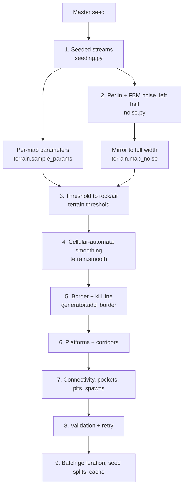

# Map generator guide

This document explains how RL-Donut builds its procedural maps: what each piece does,
why it exists, and which file and tests own it. It is updated as each step lands.

## Why the generator matters for RL

The agent trains on thousands of maps and is judged on maps it has never seen. That only
works if:

1. **The same seed always produces the same map.** Otherwise the train/test split is
   meaningless and results can't be reproduced.
2. **Every map is playable and fair.** Broken maps (sealed rooms, trap pits, unfair spawns)
   produce wasted or misleading training episodes.
3. **Variety is controlled.** Maps should differ, but along dimensions we choose and can
   measure (rock density, height bias), so we can report results per map type.

## Pipeline



| Step | Status | Code |
|---|---|---|
| 1. Seeded streams | done | `src/rl_donut/mapgen/seeding.py` |
| 2. Perlin + FBM | done | `src/rl_donut/mapgen/noise.py` |
| 3. Mirroring + threshold | done | `src/rl_donut/mapgen/terrain.py` |
| 4. Smoothing | done | `src/rl_donut/mapgen/terrain.py` |
| 5. Border + kill line | done | `src/rl_donut/mapgen/generator.py` |
| 6. Platforms + corridors | next | — |
| 7. Connectivity, pockets, pits, spawns | planned | — |
| 8. Validation + retry | planned | — |
| 9. Batch generation | planned | — |

All settings live in `src/rl_donut/mapgen/config.py`. Settings are frozen dataclasses that
reject impossible values when they are created.

---

## Step 1: Seeded streams (`seeding.py`)

**Purpose.** Turn one integer (the map seed) into a separate random number generator for
each part of the map.

**How it works.**

```python
class Stream(IntEnum):
    TERRAIN = 0     # noise gradients
    PLATFORMS = 1
    CORRIDORS = 2
    SPAWNS = 3
    DOMAIN = 4      # physics randomization (later phases)
    PARAMS = 5      # per-map parameters such as rock fraction

def make_rng(master_seed, stream, attempt=0):
    seq = np.random.SeedSequence(entropy=master_seed, spawn_key=(stream, attempt))
    return np.random.Generator(np.random.PCG64(seq))
```

`SeedSequence` hashes the seed and the key `(stream, attempt)` into a high-quality,
independent starting state. `PCG64` is the bit generator that produces the numbers.

**Why it is built this way.**

| Choice | Reason |
|---|---|
| One stream per component | If terrain code starts drawing one more number, platforms and spawns don't shift. Seed 42 stays seed 42. |
| Fixed numeric stream ids, append-only | Renumbering would change every map. New components get new numbers at the end. |
| `attempt` in the key | When a map fails validation we regenerate with `attempt + 1`. NumPy's docs warn against arithmetic seeds like `seed + k`. |
| Explicit `PCG64` | `default_rng()` is allowed to change its default algorithm in future NumPy versions. |
| Exactly pinned NumPy | NumPy only guarantees identical streams on the same build. |

**Tests** (`tests/test_seeding.py`): reproducibility, distinct streams, neighbouring seeds
uncorrelated, retries give fresh streams, invalid seeds rejected, and **golden values**:
the exact numbers seed 42 produced when the code was written. If a golden test fails,
every map has silently changed. Either pin NumPy back, or change the output deliberately
and bump `GENERATOR_VERSION`.

---

## Step 2: Perlin noise + FBM (`noise.py`)

**Purpose.** Produce a smooth, natural-looking random height field. High values will
become rock, low values air.

**How Perlin noise works.**

1. Lay a grid of cells over the map. Each cell is `cell_w × cell_h` tiles (default 16 × 10).
2. Give every grid corner a random unit vector (`random_gradients`).
3. For each tile, take the dot product of each of its cell's four corner vectors with the
   offset from that corner to the tile (`corner_dot` inside `perlin_at`).
4. Blend the four values, first horizontally, then vertically, using the **fade curve**
   `6t⁵ − 15t⁴ + 10t³` rather than plain linear interpolation.

```python
u = fade(fx)
v = fade(fy)
top = corner_dot(0, 0) + u * (corner_dot(0, 1) - corner_dot(0, 0))
bottom = corner_dot(1, 0) + u * (corner_dot(1, 1) - corner_dot(1, 0))
return top + v * (bottom - top)
```

**Why the fade curve.** Linear blending makes the slope jump at cell edges, which shows up
as straight grid-aligned creases in the terrain. The quintic curve is flat at both ends, so
the slope is continuous. `scripts/preview_noise.py` shows the creases in its "slope" panels.

**FBM (fractal Brownian motion).** `fbm()` sums several octaves of Perlin noise. Each octave
uses cells `lacunarity` (2×) smaller and contributes `persistence` (0.5×) as much:

| Octave | Cell size (tiles) | Weight |
|---|---|---|
| 1 | 16 × 10 | 1 |
| 2 | 8 × 5 | 0.5 |
| 3 | 4 × 2.5 | 0.25 |
| 4 | 2 × 1.25 | 0.125 |

Octave 1 sets the big cave layout. Later octaves add rough detail to its edges.

**Parameter choices** (in `NoiseConfig`):

| Parameter | Default | Effect |
|---|---|---|
| `cell_w`, `cell_h` | 16, 10 | Size of the largest features. Cells are wider than tall so caves form horizontal shelves and corridors, which suits a side-scroller. |
| `octaves` | 4 | More octaves add finer detail. Smoothing (step 4) erases most of the finest ones. |
| `persistence` | 0.5 | Higher means rougher walls. |
| `lacunarity` | 2 | Standard; rarely changed. |
| `fade` | quintic | `linear` is kept only for comparison. |

`NoiseConfig` refuses settings whose finest octave would have cells smaller than one tile.

**Why we wrote our own.** The noise output is part of the seed contract. A library update
that changed its internals would silently change every map. Our maps are about 4,600 tiles,
so numpy generates one in about 2 ms. Speed was never a reason to depend on a C library.

**Tests** (`tests/test_noise.py`): zero at every lattice point (a defining Perlin property),
never exceeds the theoretical bound √0.5, smooth between neighbouring tiles, quintic fade
flat at both ends, reproducible, more octaves keep the large-scale shape, invalid configs
rejected, golden values.

---

## Step 3: Mirroring and threshold to a rock/air grid (`terrain.py`)

**Purpose.** Turn continuous noise into tiles: `ROCK = 1`, `AIR = 0`, stored as `uint8`
so more tile types can be added later.

**Mirroring first (`map_noise`).** Only the left half of the noise is generated. It is
reflected to form the right half *before* thresholding, so the whole map is left/right
symmetric and neither side has an advantage:

```python
half_width = (cfg.width + 1) // 2
left = fbm(half_width, cfg.height, cfg.noise, rng)
right = left[:, : cfg.width - half_width][:, ::-1]
return np.hstack([left, right])
```

Odd widths get a single shared centre column. `TerrainConfig.mirror = False` produces
asymmetric maps, reserved for out-of-distribution evaluation.

Why mirror the *noise* and not a finished half map: smoothing a half map treats the centre
line as the map edge (rock), which grows a wall down the middle. Why left/right and not a 180°
rotation: with height bias, a rotation would give one side the ground and the other the sky.

**Per-map parameters.** `sample_params(seed, cfg)` draws two values from the `PARAMS` stream:

| Parameter | Training range | Meaning |
|---|---|---|
| `rock_fraction` | 0.40–0.55 | Share of tiles that become rock. ~40% gives open arenas with floating islands; ~55% gives cave networks. |
| `height_bias` | 0.0–0.3 | Pushes rock toward the bottom of the map: ground below, open sky above. |

Out-of-distribution test maps will use rock fractions of 30–35% and 60–65%.

**How the threshold works.**

```python
depth = (np.arange(height) / (height - 1) - 0.5)[:, None]   # -0.5 at top, +0.5 at bottom
biased = noise + height_bias * depth
n_rock = round(rock_fraction * biased.size)
cutoff = np.sort(biased, axis=None)[biased.size - n_rock]
grid = np.where(biased >= cutoff, ROCK, AIR)
```

The `n_rock` highest tiles become rock, so the rock fraction is exact. With mirroring,
every noise value appears twice, so rock is added in mirrored pairs and an odd target
count comes out one tile over.

**Why a quantile cutoff, not a fixed one.** Measured over 1,000 seeds, a fixed cutoff
tuned for a 40% average gave anything from 31% to 50% rock per map. That is uncontrolled
difficulty. With a quantile cutoff the density is exactly what was sampled, so we can
later report results by density.

**Why parameters get their own stream.** Drawing them from `TERRAIN` would shift the noise
gradients and change every map's noise.

**Tests** (`tests/test_terrain.py`): exact rock fraction without mirroring (within one tile
with it), rock sits where noise is highest, sampled values cover their ranges, retries
resample, height bias adds rock at the bottom without changing the total, no bias is
balanced on average, maps are symmetric for even and odd widths, `mirror=False` is
asymmetric, invalid ranges rejected.

---

## Step 4: Cellular-automata smoothing (`terrain.py`)

**Purpose.** Remove single-tile specks, spikes and jagged edges left by the finest noise
octaves, while keeping the large shapes.

**How it works.** Each pass counts every tile's rock neighbours (of 8) and takes a local
majority vote:

| Rock neighbours | New tile |
|---|---|
| ≥ 5 (`smooth_rock_min`) | rock |
| ≤ 3 (`smooth_air_max`) | air |
| exactly 4 | unchanged |

```python
counts = rock_neighbours(grid)          # outside the map counts as rock
grid = np.where(counts >= rock_min, ROCK, np.where(counts <= air_max, AIR, grid))
```

Leaving ties unchanged keeps the rock fraction stable. The rule treats left and right
identically, so mirrored maps stay symmetric.

**Why 3 passes.** Measured over 200 seeds, "rough" tiles (lone rock with ≤ 2 rock neighbours,
or lone air with ≥ 6) dropped from 72 per map to 7, 2 and then 1 after passes 1, 2 and 3.
More passes barely change the map.

**Rock fraction drift.** Smoothing shifts the rock fraction by about +1% on average
(−1.5% to +3.4% over 300 seeds). We accept this and keep both numbers: the sampled target
in `Terrain.params.rock_fraction` and the actual value in `Terrain.final_rock_fraction`.

**Alternatives considered.** Blurring the noise before the cutoff is equivalent to using
fewer octaves and doesn't guarantee specks disappear. Morphological erode/dilate is harsher
and can cut thin rock bridges, splitting the map.

**Output.** `terrain_grid(seed, cfg)` returns a `Terrain` with `grid` and `params`.

**Tests** (`tests/test_terrain.py`): neighbour count treats outside as rock, lone specks are
removed in one pass, ties are left unchanged, zero passes changes nothing, smoothed maps
average ≤ 3 rough tiles, drift stays under 5%, invalid smoothing settings rejected, golden
grid fingerprint for seed 42.

---

## Step 5: Border and kill line (`generator.py`)

**Purpose.** Close the map so agents can't leave through the top or sides, and define where
falling agents die.

**The pipeline entry point.** `generate_map(seed, cfg, attempt)` runs every stage and returns
a `GeneratedMap`:

| Field | Meaning |
|---|---|
| `seed`, `attempt`, `generator_version` | Exactly which generator run produced this map |
| `grid` | Tile grid indexed `[row, col]`; row 0 is the top, so y grows downward |
| `params` | The per-map values drawn from `PARAMS` |
| `terrain_rock_fraction` | Rock share after smoothing, before the border |
| `rock_fraction` | Rock share of the finished grid |
| `kill_y` | Agents whose whole hitbox is below this y are dead |

**Border.** `add_border` sets a 1-tile frame of rock (`MapConfig.border`). The top is a
solid ceiling, so agents can't fly above the map and camp off-screen. The engine (Phase 2)
also treats everything beyond the top and sides as solid, as a safety net.

Why 1 tile is enough: the fastest motion is a 20 tiles/s fall at 30 physics ticks per
second, which is 0.67 tiles per tick. An agent can't skip over a 1-tile wall in one tick.
Phase 2 will test that motion per tick stays below 1 tile. A 1-tile border costs about 6%
of the map; 2 tiles would cost about 12%.

**Kill line.** `kill_y = height + PitConfig.kill_margin` (default 3 tiles). An agent dies
once its whole hitbox is beyond `kill_y`, so a fall into a pit is briefly visible before
the death. Generator and engine read the same value.

**Pits (configured here, carved in step 7).** `PitConfig` holds the pit settings and
`Stream.PITS` their randomness:

| Setting | Default | Meaning |
|---|---|---|
| `count` | (0, 2) | 0 = closed floor, 1 = pit centred on the seam, 2 = mirrored pair. Training starts at (0, 0) as a curriculum step. |
| `width` | (3, 6) | Tiles; at least 2 (agent clearance). ≤ 6 is crossable with about 1 s of jetpack. |
| `max_depth` | 10 | Deepest shaft carved upward from the bottom edge to reach air |

Pits are carved after pocket filling in step 7, because a prototype carved a pit straight
into a sealed air bubble that no one could ever reach. In step 7 a pit is only accepted if
it opens into the main play region.

**Tests** (`tests/test_generator.py`): border solid on all four sides for thickness 1 and 2,
interior untouched, input not modified, maps stay symmetric, metadata recorded, kill margin
configurable, reproducible, invalid pit and border settings rejected, golden map for seed 42.

---

## Glossary

| Term | Meaning |
|---|---|
| Seed | Integer that fully determines one map |
| Stream | Independent random generator for one map component |
| Octave | One layer of Perlin noise at a given scale |
| Persistence | Weight multiplier between octaves |
| Lacunarity | Frequency multiplier between octaves |
| Rock fraction | Share of tiles that are rock after thresholding |
| Height bias | Extra rock toward the bottom of the map |
| Golden test | Test that pins exact outputs so silent changes are caught |
| OOD | Out-of-distribution: settings never seen in training, used to test generalization |
| Pit | Gap through the bottom edge; falling through it kills the agent |
| Kill line | The y position below which a falling agent is dead |
| Curriculum | Training that starts easy (e.g. no pits) and gets harder |
