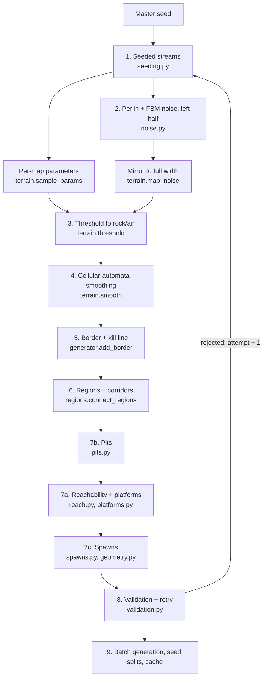
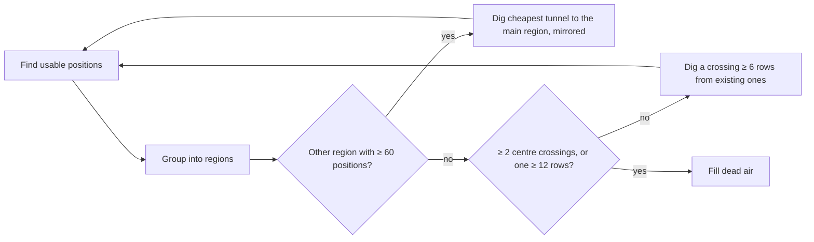

# Map generator guide

This document explains how RL-Donut builds its procedural maps: what each piece does,
why it exists, and which file and tests own it. It is updated as each step lands.

## Why the generator matters for RL

The agent trains on thousands of maps and is judged on maps it has never seen. That only
works if:

1. **The same seed always produces the same map.** Otherwise the train/test split is
   meaningless and results can't be reproduced.
2. **Every map is playable and fair.** Broken maps (sealed rooms, trap pits, unfair spawns)
   produce wasted or misleading training episodes.
3. **Variety is controlled.** Maps should differ, but along dimensions we choose and can
   measure (rock density, height bias), so we can report results per map type.

## Pipeline



| Step | Status | Code |
|---|---|---|
| 1. Seeded streams | done | `src/rl_donut/mapgen/seeding.py` |
| 2. Perlin + FBM | done | `src/rl_donut/mapgen/noise.py` |
| 3. Mirroring + threshold | done | `src/rl_donut/mapgen/terrain.py` |
| 4. Smoothing | done | `src/rl_donut/mapgen/terrain.py` |
| 5. Border + kill line | done | `src/rl_donut/mapgen/generator.py` |
| 6. Regions + corridors | done | `src/rl_donut/mapgen/regions.py` |
| 7a. Reachability + platforms | done | `src/rl_donut/mapgen/reach.py`, `src/rl_donut/mapgen/platforms.py` |
| 7b. Pits | done | `src/rl_donut/mapgen/pits.py` |
| 7c. Spawns | done | `src/rl_donut/mapgen/spawns.py`, `src/rl_donut/mapgen/geometry.py` |
| 8. Validation + retry | done | `src/rl_donut/mapgen/validation.py` |
| 9. Batch generation | next | — |

Steps are numbered in the order they were built. In the pipeline, pits (7b) run before
platforms (7a), so ledges can repair anything a pit breaks and no platform covers a pit.

All settings live in `src/rl_donut/mapgen/config.py`. Settings are frozen dataclasses that
reject impossible values when they are created.

---

## Step 1: Seeded streams (`seeding.py`)

**Purpose.** Turn one integer (the map seed) into a separate random number generator for
each part of the map.

**How it works.**

```python
class Stream(IntEnum):
    TERRAIN = 0     # noise gradients
    PLATFORMS = 1
    CORRIDORS = 2
    SPAWNS = 3
    DOMAIN = 4      # physics randomization (later phases)
    PARAMS = 5      # per-map parameters such as rock fraction

def make_rng(master_seed, stream, attempt=0):
    seq = np.random.SeedSequence(entropy=master_seed, spawn_key=(stream, attempt))
    return np.random.Generator(np.random.PCG64(seq))
```

`SeedSequence` hashes the seed and the key `(stream, attempt)` into a high-quality,
independent starting state. `PCG64` is the bit generator that produces the numbers.

**Why it is built this way.**

| Choice | Reason |
|---|---|
| One stream per component | If terrain code starts drawing one more number, platforms and spawns don't shift. Seed 42 stays seed 42. |
| Fixed numeric stream ids, append-only | Renumbering would change every map. New components get new numbers at the end. |
| `attempt` in the key | When a map fails validation we regenerate with `attempt + 1`. NumPy's docs warn against arithmetic seeds like `seed + k`. The `PARAMS` stream always uses attempt 0, so a seed's design settings survive retries (step 8). |
| Explicit `PCG64` | `default_rng()` is allowed to change its default algorithm in future NumPy versions. |
| Exactly pinned NumPy | NumPy only guarantees identical streams on the same build. |

**Tests** (`tests/test_seeding.py`): reproducibility, distinct streams, neighbouring seeds
uncorrelated, retries give fresh streams, invalid seeds rejected, and **golden values**:
the exact numbers seed 42 produced when the code was written. If a golden test fails,
every map has silently changed. Either pin NumPy back, or change the output deliberately
and bump `GENERATOR_VERSION`.

---

## Step 2: Perlin noise + FBM (`noise.py`)

**Purpose.** Produce a smooth, natural-looking random height field. High values will
become rock, low values air.

**How Perlin noise works.**

1. Lay a grid of cells over the map. Each cell is `cell_w × cell_h` tiles (default 16 × 10).
2. Give every grid corner a random unit vector (`random_gradients`).
3. For each tile, take the dot product of each of its cell's four corner vectors with the
   offset from that corner to the tile (`corner_dot` inside `perlin_at`).
4. Blend the four values, first horizontally, then vertically, using the **fade curve**
   `6t⁵ − 15t⁴ + 10t³` rather than plain linear interpolation.

```python
u = fade(fx)
v = fade(fy)
top = corner_dot(0, 0) + u * (corner_dot(0, 1) - corner_dot(0, 0))
bottom = corner_dot(1, 0) + u * (corner_dot(1, 1) - corner_dot(1, 0))
return top + v * (bottom - top)
```

**Why the fade curve.** Linear blending makes the slope jump at cell edges, which shows up
as straight grid-aligned creases in the terrain. The quintic curve is flat at both ends, so
the slope is continuous. `scripts/preview_noise.py` shows the creases in its "slope" panels.

**FBM (fractal Brownian motion).** `fbm()` sums several octaves of Perlin noise. Each octave
uses cells `lacunarity` (2×) smaller and contributes `persistence` (0.5×) as much:

| Octave | Cell size (tiles) | Weight |
|---|---|---|
| 1 | 16 × 10 | 1 |
| 2 | 8 × 5 | 0.5 |
| 3 | 4 × 2.5 | 0.25 |
| 4 | 2 × 1.25 | 0.125 |

Octave 1 sets the big cave layout. Later octaves add rough detail to its edges.

**Parameter choices** (in `NoiseConfig`):

| Parameter | Default | Effect |
|---|---|---|
| `cell_w`, `cell_h` | 16, 10 | Size of the largest features. Cells are wider than tall so caves form horizontal shelves and corridors, which suits a side-scroller. |
| `octaves` | 4 | More octaves add finer detail. Smoothing (step 4) erases most of the finest ones. |
| `persistence` | 0.5 | Higher means rougher walls. |
| `lacunarity` | 2 | Standard; rarely changed. |
| `fade` | quintic | `linear` is kept only for comparison. |

`NoiseConfig` refuses settings whose finest octave would have cells smaller than one tile.

**Why we wrote our own.** The noise output is part of the seed contract. A library update
that changed its internals would silently change every map. Our maps are about 4,600 tiles,
so numpy generates one in about 2 ms. Speed was never a reason to depend on a C library.

**Tests** (`tests/test_noise.py`): zero at every lattice point (a defining Perlin property),
never exceeds the theoretical bound √0.5, smooth between neighbouring tiles, quintic fade
flat at both ends, reproducible, more octaves keep the large-scale shape, invalid configs
rejected, golden values.

---

## Step 3: Mirroring and threshold to a rock/air grid (`terrain.py`)

**Purpose.** Turn continuous noise into tiles: `ROCK = 1`, `AIR = 0`, stored as `uint8`
so more tile types can be added later.

**Mirroring first (`map_noise`).** Only the left half of the noise is generated. It is
reflected to form the right half *before* thresholding, so the whole map is left/right
symmetric and neither side has an advantage:

```python
half_width = (cfg.width + 1) // 2
left = fbm(half_width, cfg.height, cfg.noise, rng)
right = left[:, : cfg.width - half_width][:, ::-1]
return np.hstack([left, right])
```

Odd widths get a single shared centre column. `TerrainConfig.mirror = False` produces
asymmetric maps, reserved for out-of-distribution evaluation.

Why mirror the *noise* and not a finished half map: smoothing a half map treats the centre
line as the map edge (rock), which grows a wall down the middle. Why left/right and not a 180°
rotation: with height bias, a rotation would give one side the ground and the other the sky.

**Per-map parameters.** `sample_params(seed, cfg)` draws a seed's design settings from the
`PARAMS` stream. They depend only on the seed, never on the retry attempt (see step 8):

| Parameter | Training range | Meaning |
|---|---|---|
| `rock_fraction` | 0.40–0.55 | Share of tiles that become rock. ~40% gives open arenas with floating islands; ~55% gives cave networks. |
| `height_bias` | 0.0–0.3 | Pushes rock toward the bottom of the map: ground below, open sky above. |
| `pit_count` | 0–2 | Pits the map must have (step 7b). |

Out-of-distribution test maps will use rock fractions of 30–35% and 60–65%.

**How the threshold works.**

```python
depth = (np.arange(height) / (height - 1) - 0.5)[:, None]   # -0.5 at top, +0.5 at bottom
biased = noise + height_bias * depth
n_rock = round(rock_fraction * biased.size)
cutoff = np.sort(biased, axis=None)[biased.size - n_rock]
grid = np.where(biased >= cutoff, ROCK, AIR)
```

The `n_rock` highest tiles become rock, so the rock fraction is exact. With mirroring,
every noise value appears twice, so rock is added in mirrored pairs and an odd target
count comes out one tile over.

**Why a quantile cutoff, not a fixed one.** Measured over 1,000 seeds, a fixed cutoff
tuned for a 40% average gave anything from 31% to 50% rock per map. That is uncontrolled
difficulty. With a quantile cutoff the density is exactly what was sampled, so we can
later report results by density.

**Why parameters get their own stream.** Drawing them from `TERRAIN` would shift the noise
gradients and change every map's noise.

**Tests** (`tests/test_terrain.py`): exact rock fraction without mirroring (within one tile
with it), rock sits where noise is highest, sampled values cover their ranges, retries
resample, height bias adds rock at the bottom without changing the total, no bias is
balanced on average, maps are symmetric for even and odd widths, `mirror=False` is
asymmetric, invalid ranges rejected.

---

## Step 4: Cellular-automata smoothing (`terrain.py`)

**Purpose.** Remove single-tile specks, spikes and jagged edges left by the finest noise
octaves, while keeping the large shapes.

**How it works.** Each pass counts every tile's rock neighbours (of 8) and takes a local
majority vote:

| Rock neighbours | New tile |
|---|---|
| ≥ 5 (`smooth_rock_min`) | rock |
| ≤ 3 (`smooth_air_max`) | air |
| exactly 4 | unchanged |

```python
counts = rock_neighbours(grid)          # outside the map counts as rock
grid = np.where(counts >= rock_min, ROCK, np.where(counts <= air_max, AIR, grid))
```

Leaving ties unchanged keeps the rock fraction stable. The rule treats left and right
identically, so mirrored maps stay symmetric.

**Why 3 passes.** Measured over 200 seeds, "rough" tiles (lone rock with ≤ 2 rock neighbours,
or lone air with ≥ 6) dropped from 72 per map to 7, 2 and then 1 after passes 1, 2 and 3.
More passes barely change the map.

**Rock fraction drift.** Smoothing shifts the rock fraction by about +1% on average
(−1.5% to +3.4% over 300 seeds). We accept this and keep both numbers: the sampled target
in `Terrain.params.rock_fraction` and the actual value in `Terrain.final_rock_fraction`.

**Alternatives considered.** Blurring the noise before the cutoff is equivalent to using
fewer octaves and doesn't guarantee specks disappear. Morphological erode/dilate is harsher
and can cut thin rock bridges, splitting the map.

**Output.** `terrain_grid(seed, cfg)` returns a `Terrain` with `grid` and `params`.

**Tests** (`tests/test_terrain.py`): neighbour count treats outside as rock, lone specks are
removed in one pass, ties are left unchanged, zero passes changes nothing, smoothed maps
average ≤ 3 rough tiles, drift stays under 5%, invalid smoothing settings rejected, golden
grid fingerprint for seed 42.

---

## Step 5: Border and kill line (`generator.py`)

**Purpose.** Close the map so agents can't leave through the top or sides, and define where
falling agents die.

**The pipeline entry point.** `generate_map(seed, cfg, attempt)` runs every stage and returns
a `GeneratedMap`:

| Field | Meaning |
|---|---|
| `seed`, `attempt`, `generator_version` | Exactly which generator run produced this map |
| `grid` | Tile grid indexed `[row, col]`; row 0 is the top, so y grows downward |
| `params` | The per-map values drawn from `PARAMS` |
| `terrain_rock_fraction` | Rock share after smoothing, before the border |
| `rock_fraction` | Rock share of the finished grid |
| `kill_y` | Agents whose whole hitbox is below this y are dead |

**Border.** `add_border` sets a 1-tile frame of rock (`MapConfig.border`). The top is a
solid ceiling, so agents can't fly above the map and camp off-screen. The engine (Phase 2)
also treats everything beyond the top and sides as solid, as a safety net.

Why 1 tile is enough: the fastest motion is a 20 tiles/s fall at 30 physics ticks per
second, which is 0.67 tiles per tick. An agent can't skip over a 1-tile wall in one tick.
Phase 2 will test that motion per tick stays below 1 tile. A 1-tile border costs about 6%
of the map; 2 tiles would cost about 12%.

**Kill line.** `kill_y = height + PitConfig.kill_margin` (default 3 tiles). An agent dies
once its whole hitbox is beyond `kill_y`, so a fall into a pit is briefly visible before
the death. Generator and engine read the same value.

**Pits (configured here, carved in step 7b).** `PitConfig` holds the pit settings; the
count is a per-seed parameter and `Stream.PITS` supplies the positions:

| Setting | Default | Meaning |
|---|---|---|
| `count` | (0, 2) | 0 = closed floor, 1 = pit centred on the seam, 2 = mirrored pair. Training starts at (0, 0) as a curriculum step. |
| `width` | (3, 6) | Tiles; at least 2 (agent clearance). ≤ 6 is crossable with about 1 s of jetpack. |
| `max_depth` | 10 | Deepest shaft carved upward from the bottom edge to reach air |

Pits are carved in step 7, after step 6 has filled the sealed pockets, because a prototype
carved a pit straight into a sealed air bubble that no one could ever reach. In step 7 a pit
is only accepted if it opens into the main play region.

**Tests** (`tests/test_generator.py`): border solid on all four sides for thickness 1 and 2,
interior untouched, input not modified, maps stay symmetric, metadata recorded, kill margin
configurable, reproducible, invalid pit and border settings rejected, golden map for seed 42.

---

## Step 6: Regions and corridors (`regions.py`)

**Purpose.** Turn the terrain into **one connected play space** that an agent's body can
move through, with more than one route between the two halves. This step uses no
randomness: its output is fully determined by the grid it receives.

### Positions, not tiles

The agent's hitbox is 0.8 × 1.6 tiles. Routes are planned for a **2 × 3 clearance box**
(hitbox plus margin, `RegionConfig.clearance_w/h`), so no required route forces an agent
through a gap exactly its own size.

A **position** is a box anchor: anchor `(y, x)` means the box covers rows `y..y+2` and
columns `x..x+1`. A position is usable when every tile in its box is air.
`box_rock_counts` computes the number of rock tiles in the box at every anchor in one pass,
using a 2D cumulative sum. A count of 0 means usable.

### The four stages of `connect_regions`



1. **Regions.** `label_regions` flood-fills usable positions with 4-connectivity (no
   diagonal squeezing) and returns each region's size. The largest is the **main region**.
2. **Joining.** Each other region with at least `min_region` (60) positions is joined to the
   main region by the cheapest tunnel; smaller regions are left to be filled.
3. **Centre crossings.** If the main region crosses the centre line fewer than
   `min_crossings` (2) times and no single opening is at least `wide_crossing` (12) rows
   tall, another crossing is dug at least `crossing_gap` (6) rows away from existing ones.
4. **Dead air.** Every air tile that no box in the main region can cover is filled with rock.

### How the cheapest tunnel is found

`cheapest_tunnel` runs **Dijkstra's algorithm** over positions. It starts from every
position in the region being joined and repeatedly expands the cheapest position reached
so far. Entering a position costs `1 + rock_cost × (rock tiles in its box)`, with
`rock_cost = 12`. The first time it reaches the main region, it has found the cheapest
possible tunnel. Because rock is so much more expensive than air, the tunnel follows
existing caves and digs only the gaps.

**Staircases, not shafts.** Digging vertically right after another vertical step costs
`vertical_run_cost` (3) times more. The cheapest route through rock then alternates up and
sideways, which leaves a foothold on every step. Without this, tunnels were often straight
2-wide shafts; a shaft taller than the climb budget (step 7a) is a one-way door, because you
can fall down it but have nowhere to land and refuel on the way up. To keep the search exact,
its state is (position, whether the last step was vertical).

`carve` clears the box at every position on the path, and at its mirror image, so maps stay
symmetric. Positions whose box would touch the border are not allowed, so the frame is
never dug.

### Why each rule exists

| Rule | Reason |
|---|---|
| Cheapest path instead of straight lines or random walks | Short, natural tunnels (mean 38 tiles dug per map over 300 seeds). Straight lines dig too much; random walks are unpredictable. |
| Fill regions < 60 positions | Too small to matter for play; joining them would just add tunnels |
| Fill all dead air | Agents can't use it; thin cracks would let bullets through gaps no agent can enter; the visible map equals the playable map |
| ≥ 2 crossings | A single narrow choke point makes camping it the dominant strategy |
| …or one opening ≥ 12 rows | The first version counted open centres 35–44 rows tall as "1 route" on 39 of 300 maps. Those are wide open, not choke points; one agent can't block 12 rows |

### What it records

`GeneratedMap` gains `tunnels`, `crossings` (separate routes across the centre line) and
`widest_crossing` (tallest opening, in anchor rows), plus `layers["dug"]` and
`layers["filled"]`: masks of the tiles this step changed. `scripts/preview_maps.py` draws
dug tiles in blue and filled tiles in orange.

Measured over 1,000 seeds: every map is one region with no dead air, all are symmetric, and
all meet the crossing rule. With staircase tunnels (300 seeds), the step takes about 13 ms
per map and digs 39 tiles on average.

**Tests** (`tests/test_regions.py`): box counts, 1-tile tunnels have no positions, separate
rooms are separate regions, tunnels go through gaps rather than digging, sealed walls get
dug, and on 60 generated maps: exactly one region, no dead air, symmetric, border intact,
crossing rule met, recorded crossings match the grid, layers match grid changes. Plus seam
column symmetry, config validation, and staircase tunnels: through solid rock, a plain search
digs a 23-step straight shaft, while the staircase search never takes two vertical steps in a row.

---

## Step 7a: Jetpack reachability and platforms (`reach.py`, `platforms.py`)

Step 6 guarantees an agent-sized box can *fit* everywhere. That isn't the same as being able
to *get* everywhere: falling is free, but climbing burns jetpack fuel. This step measures
where an agent can really go, then adds floating platforms where it can't.

### The climb contract

`MapConfig.climb_budget = 12` is a promise between the map generator and the physics engine.
The generator never requires a climb taller than this, and Phase 2 must include a test
showing the engine can climb at least this far on one full tank.

### The flight model (`reach.py`)

- A **standing spot** is a box position resting on rock. Touching standing spots on the same
  row form a **floor segment**: an agent can walk along it for free.
- Flying costs fuel: up 2 units, sideways 1, down 0. A full tank holds `2 × climb_budget` = 24.
  Landing on any standing spot refuels and ends the flight.
- `flight_costs` computes, for every segment at once (numpy, batched), the cheapest fuel cost
  to every position. Each sweep applies free falling, then one costed move.
- `reach[a, b]` is true when one flight from `a` can land on `b`. `transitive_closure` turns
  that into "can get there eventually, maybe via other floors".
- The **main group** is the largest set of floors that can all reach each other.

From this, three measures:

| Measure | Meaning |
|---|---|
| `fully_reachable` | Every floor is in the main group |
| `trap_free` | Every floor you can get to from the main group, you can get back from |
| `stranded_fraction` | Share of standing spots outside the main group |

A **trap** (reachable but no way back) is always bad: an agent that falls in is stuck for
the rest of the episode. An **unreachable** floor that isn't a trap is harmless, because
nobody can ever be there; it only wastes space.

The model is deliberately conservative: real flight can arc and use momentum. Phase 2
checks it against real physics.

### Platforms (`platforms.py`)

Platforms are solid rock strips 1 tile thick and 4–8 tiles wide. They need 3 rows of clear
air above (standing room) and below (room to pass under), plus a 2-tile margin on each
side. They are mirrored across the centre line, or become one centred platform when a pair
would overlap the seam (`placement`). Every placement must keep the map one region and keep
the centre-crossing rule (`region_check`).

`place_platforms` works in three passes:

1. **Ledges.** While floors are stranded, pick the largest one and try ledges near the
   midpoint between it and the nearest reachable floor (random width and small jitter, up to
   60 tries and 8 reachability checks). Keep a ledge only if the reachable area grows;
   otherwise give up on that floor.
2. **Unreachable air** (`fill_unreachable`). `occupiable_tiles` finds every tile a box can
   cover on some flight from the main group. The rest is filled with rock, but only when it
   is at most `max_unreachable_fill` (3%) of the map's air and the region and crossing rules
   still hold. Larger unreachable caverns are left as they are; step 8 rejects those maps.
3. **Cover.** One placement per 800 air tiles (at most 4), at random positions. Cover must
   never shrink the reachable area or increase the stranded share.

### What was tried, and what the numbers say

Over 200 seeds:

| Version | Fully reachable | Acceptable |
|---|---|---|
| No platforms | 40% | — |
| Ledges | 78% | — |
| + staircase tunnels (step 6) | 94% | 94.5% |

A map is **acceptable** when it is trap-free and at most `max_stranded` (2%) of its floor is
unreachable. The remaining ~5% are mostly upper caverns joined to the rest only through
necks taller than the climb budget. Step 8 will reject and retry them with the next
`attempt` (about 0.2 s each).

Two ideas didn't make it:
- **Stepping-stone ledges** placed right under a shelf's edge. No gain: on the failing maps,
  every candidate failed the space check, because there is no 8-row-tall air pocket there.
- **Filling all unreachable air.** It would delete up to 41% of a map's air.

Cost: about 190 ms per map in total, mostly reachability checks (~30 ms each).

### What it records

`GeneratedMap` gains `platforms` (row, x0, width, and kind: `"ledge"` or `"cover"`),
`fully_reachable`, `trap_free` and `stranded_fraction`, plus `layers["platforms"]` and
`layers["unreachable"]`. `scripts/preview_maps.py` draws platforms in green and filled
unreachable air in purple, and titles flag any map with a trap.

**Tests:**
- `tests/test_reach.py`: standing spots and floor segments; a flat room is fully reachable; a
  step of `climb_budget − 2` can be climbed and `climb_budget + 2` can't. An unreachable high
  shelf is not a trap, while a low floor under a tall step is. Occupiable air in low and tall
  rooms. Recorded values match recomputation on 30 maps, and at least 85% of maps are
  acceptable.
- `tests/test_platforms.py`: the placement rules (mirrored, centred near the seam, needs
  clear air, stays inside the border). On 30 maps: platforms are rock and match the layer,
  keep standing room, are symmetric, and keep one region; the fill is small and can be
  disabled. Plus reproducibility and config validation.

---

## Step 7b: Bottom pits (`pits.py`)

A pit is a shaft cut up through the bottom edge. An agent that falls through it and drops
below the kill line (step 5) dies. Pits teach fuel management: you can jetpack back out
of a pit if you still have fuel.

### Where a pit can go

- **Count** is the seed's `MapParams.pit_count`: 0, 1 (centred on the seam) or 2 (a
  mirrored pair, at least one clearance box apart). Positions come from the `PITS` stream. Training starts at `count=(0, 0)` and widens to
  `(0, 2)` as a curriculum step.
- **Width** is 3–6 tiles. A centred pit adjusts its width by one so it stays symmetric.
- **Opening.** Every column of the pit must have its lowest air resting on floor that
  belongs to the main reachable group (`main_floor_columns`). Pits sit on walked paths,
  not under caverns nobody visits.
- **Depth.** Each column is cut from its lowest air down through the bottom edge, at most
  `max_depth` (10) rock tiles.

### What a pit must not break

Each candidate (up to `tries` = 40 random positions) is cut into a copy of the map and kept
only if the map stays one region, keeps the centre-crossing rule, strands no extra floor,
and stays trap-free. If nothing fits, no pits are cut and `pits_requested` records what the
seed asked for. **Step 8 rejects any map with fewer pits than requested** and retries with
the next `attempt`, so a map always gets the count it asked for.

### Pits and the flight model

No new code was needed. A pit shaft has no rock under it, so it contains no standing
spots: a fall into it never lands anywhere, which the flight model treats as leaving the
map, not as a trap. Crossing a pit costs at most 6 sideways moves out of a 24-unit tank.

### No lids

Platforms may not use any column within `platform_margin` (2) tiles of a pit
(`pit_columns`, passed to `place_platforms`). A ledge over a pit would act as a lid and
make it harmless.

### Numbers (200 seeds)

| Requested | Maps | Placed in full |
|---|---|---|
| 0 | 65 | 65 |
| 1 (centred) | 69 | 28 (41%) |
| 2 (pair) | 66 | 54 (82%) |

A centred pit needs main-group floor right at the bottom of the seam, which only about half
of all maps have. Step 8 measures the real retry cost. Most shafts are shallow (median 7
tiles), and all maps stay symmetric.

### What it records

`GeneratedMap` gains `pits` (x0, width, and `top`: the highest opening row), `pits_requested`
and `layers["pits"]` (tiles the shafts cleared). The preview draws pits in red, and titles
show placed/requested pits.

**Tests** (`tests/test_pits.py`): lowest air per column, centred and paired spans are
symmetric, the platform margin around pits, both pit counts cut through a room's floor,
shafts deeper than `max_depth` are refused, zero pits changes nothing, and falling into a
pit is not a trap. On 40 generated maps: pits open through the bottom edge, are symmetric
and fully counted, keep one region and no traps, have no platform above them, and at least
10 maps get pits. Plus config validation and a golden test for seed 10's pits.

---

## Step 7c: Spawn points (`spawns.py`, `geometry.py`)

Spawn points are where agents enter the match and respawn. Bad spawns ruin training: an
agent that can be shot the moment it appears learns nothing useful.

### The rules

- **On main floor.** A spawn is a standing spot in the main reachable group, so it is never
  in a trap or an unreachable cavern.
- **Mirrored teams.** Team A spawns on the left half; team B gets the exact mirror images.
  The map is mirrored too, so both teams get identical geometry.
- **No line of sight to any enemy spawn**, checked in both directions between box centres.
- **Distances:** at least `pit_gap` (6) tiles from a pit, at least `centre_gap` (16) tiles
  between a spawn's box and the centre line (so opposing spawns are ≥ 34 tiles apart), and at
  least `spacing` (6) tiles between two spawns of the same team.
- **Count:** `per_team` (6) per team. That covers 1v1 and 2v2 and leaves spares, so the
  engine can respawn an agent where no living enemy can see it. Maps that can't fit them all
  are rejected by step 8.

Spawns are picked in random order from the `SPAWNS` stream, keeping each spot that passes
every rule. Random (rather than always spreading spawns as far apart as possible) keeps
layouts varied, so agents can't memorise a spawn pattern.

### Line of sight (`geometry.py`)

`line_of_sight` walks the grid exactly (the Amanatides–Woo method): it visits every tile
the segment passes through, in order, and stops at the first rock tile. When the segment
passes exactly through a tile corner, both tiles beside the corner are checked, so it can't
slip between two diagonal rocks. Platforms are rock, so they block sight. Phase 2's hitscan
weapons will use the same function, so "can't see" and "can't be shot" always agree.

Over 10,000 random lines on generated maps, sampling a point every quarter tile called 46
lines clear that actually clip a rock corner; the exact walk catches them all.

### Numbers (200 seeds)

| Rules | 6 spawns per team fit |
|---|---|
| spacing 8, centre gap 16 | 82.5% |
| **spacing 6, centre gap 16 (chosen)** | 92.0% |
| spacing 6, centre gap 12 | 94.5% |

Step 8 measures the combined retry cost of all rules.

### What it records

`GeneratedMap.spawns` holds `team_a` and `team_b`: tuples of `Spawn(y, x)` box anchors.
The preview draws team A in cyan and team B in pink, and titles show placed/required spawns.

**Tests:**
- `tests/test_geometry.py`: open space is clear; walls and tiles on the path block; tiles
  beside the path don't; no slipping between diagonal rocks; a corner clip that
  quarter-tile sampling misses; starts or ends in rock and lines leaving the map are blocked;
  and whenever very dense sampling finds rock, the exact walk does too.
- `tests/test_spawns.py`: mirroring; on 40 maps, teams are mirror images, spawns stand on
  main floor, no spawn sees an enemy spawn, every distance rule holds, and at least 80% of
  maps get all 6. Plus a configurable count, impossible rules giving no spawns,
  reproducibility, config validation, and seed 42's spawns in the golden test.

---

## Step 8: Validation and retry (`validation.py`)

Earlier steps try hard to make every map good, but some can't be fixed. This step decides
which maps we keep, and retries the rest.

### `validate(map, cfg)`

Returns the list of reasons a map is rejected; an empty list means it's valid.

| Reason | Rejected when |
|---|---|
| `trap` | Some floor reachable from the main area has no way back |
| `stranded` | More than `max_stranded` (2%) of floor is unreachable |
| `pits` | Fewer pits than the seed's `pit_count` |
| `spawns` | Fewer than `spawns.per_team` (6) spawns per team |
| `asymmetric` | The grid is not a left/right mirror image (safety re-check) |
| `regions` | Not one region, or the centre-crossing rule fails (safety re-check) |
| `border` | The frame is broken anywhere other than a pit (safety re-check) |

The last three re-check guarantees earlier steps already make. They are cheap and catch
bugs if those steps ever change.

### `generate_valid_map(seed, cfg)`

Tries attempts 0, 1, 2, … and returns the first map with no reasons. The map records which
`attempt` passed and `rejections`: the reasons for every earlier attempt. After
`max_attempts` (30) failures it raises `MapGenerationError`.

### Why design settings stay fixed across retries

Pass rates depend on the map's own settings. Over 400 seeds, first attempts passed 93% of
the time with 0 pits, 34% with 1 pit and 65% with 2, and 75% at 40–45% rock against 54% at
50–55%. If a retry re-drew everything, the kept maps would drift toward easy settings: the
pit-count mix would become 49% / 18% / 34% instead of a third each, and low-rock maps would
be over-represented. That would quietly break the pit curriculum and per-map-type results.

So a seed's **design settings** (`MapParams`: rock fraction, height bias, pit count) always
come from attempt 0, and retries re-draw only the **geometry** (terrain noise, pit
positions, platforms, spawns).

### Numbers (3,000 seeds)

- No seed exhausted its attempts. Mean 1.97 attempts per map, median 1, 99th percentile 12,
  worst 24.
- Kept maps follow the intended settings: pit counts 32.6% / 34.5% / 32.9%, mean rock
  fraction 0.473 (range midpoint 0.475).
- Rejection reasons, counted over all failed attempts: `pits` 823, `spawns` 125,
  `stranded` 89, `trap` 45.
- The hardest combination (1 centred pit at 50–55% rock) passes 27% of attempts, so about
  0.1 seeds per 12,000 would hit the 30-attempt cap. Step 9 decides what to do then.

### What it records

`GeneratedMap` gains `rejections`, and `MapParams` gains `pit_count`.
`scripts/preview_maps.py` now shows validated maps (attempt number in each title); `--raw`
shows first attempts instead.

**Tests** (`tests/test_validation.py`): a valid map has no reasons; each reason is detected
on a deliberately broken map; retries record why earlier attempts failed, and those reasons
match re-validating each attempt; the kept map equals that plain attempt; design settings
stay fixed across attempts; a first-attempt seed has no rejections; exhausting attempts
raises; config validation; and a golden retry history for seed 0. `tests/test_terrain.py`
checks that parameters stay fixed across retries and that pit counts cover 0–2 evenly.

---

## Glossary

| Term | Meaning |
|---|---|
| Seed | Integer that fully determines one map |
| Stream | Independent random generator for one map component |
| Octave | One layer of Perlin noise at a given scale |
| Persistence | Weight multiplier between octaves |
| Lacunarity | Frequency multiplier between octaves |
| Rock fraction | Share of tiles that are rock after thresholding |
| Height bias | Extra rock toward the bottom of the map |
| Golden test | Test that pins exact outputs so silent changes are caught |
| OOD | Out-of-distribution: settings never seen in training, used to test generalization |
| Pit | Gap through the bottom edge; falling through it kills the agent |
| Kill line | The y position below which a falling agent is dead |
| Curriculum | Training that starts easy (e.g. no pits) and gets harder |
| Clearance box | The 2 × 3 tile box that must fit in air for a position to be usable |
| Position / anchor | Top-left tile of a clearance box placement |
| Region | Group of usable positions connected without diagonal moves |
| Main region | The largest region; after step 6, the only one |
| Dead air | Air tiles no agent box in the main region can cover |
| Centre crossing | A separate route across the map's centre line |
| Dijkstra's algorithm | Shortest-path search that always expands the cheapest point reached so far |
| Staircase tunnel | Dug route that alternates up and sideways, leaving a foothold on every step |
| Climb budget | Tallest climb the map may require; the engine must manage it on one tank |
| Standing spot | Box position resting on rock, where an agent can land and refuel |
| Floor segment | Touching standing spots on one row; walkable for free |
| Main group | Largest set of floors that can all reach each other |
| Trap | Floor you can get to but never leave |
| Stranded | Floor outside the main group |
| Ledge / cover | Platform added to restore reachability / platform added for cover |
| Spawn point | Standing spot where an agent enters the match or respawns |
| Line of sight | A straight segment between two points that touches no rock |
| Grid walk (DDA) | Visiting every tile a segment passes through, in order |
| Attempt | One try at generating a seed's map; retries use attempt 1, 2, … |
| Design settings | A seed's rock fraction, height bias and pit count; fixed across attempts |
| Rejection reason | Why validation refused an attempt (e.g. `pits`, `trap`) |
