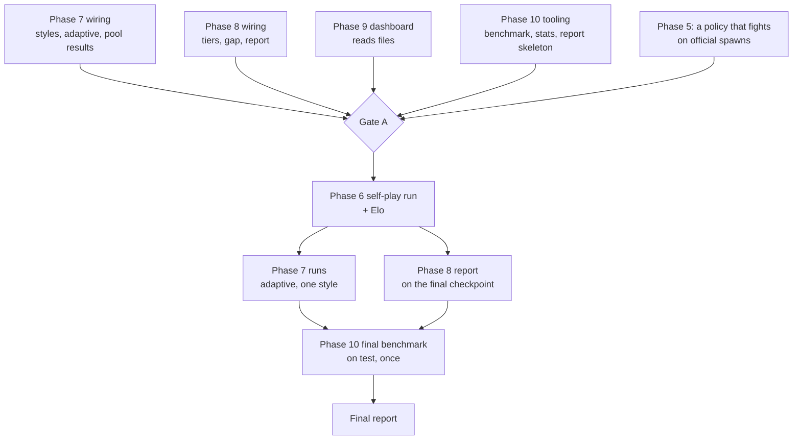

# RL-Donut: implementation plan from Phase 7 to the end

**Status note, 24 November 2026.** The milestone table in section 1.1 is corrected for what
is on `main` now. Later sections are the plan as it was written. Some of them still say a
Phase 5 change is not on `origin/main`, that the dashboard has not been started, or that
the reward is about to gain see-enemy and approach bonuses. Those bonuses are not in
`src/rl_donut/rl/rewards.py`. Where a later section disagrees with `docs/PROGRESS.md`, use
`docs/PROGRESS.md`.

This plan takes the project from where it stands today to the final report. It is written
for the teammate who builds it. It covers the context, the order of work, the code to
write in each phase, every decision with a default, and how each piece merges into `main`.

The project has ten phases. Phase 10 (benchmarks and the final report) is the last, so
this plan covers Phases 7, 8, 9 and 10, plus the leftovers from Phases 5 and 6 that those
phases depend on.

| Section | What it covers |
|---|---|
| [1. Context](#1-context) | What the project is, what is done, what has been measured |
| [2. Critical path](#2-critical-path) | What blocks what, and what to do if Phase 5 runs out of time |
| [3. Unblocking Phase 5](#3-unblocking-phase-5) | Ideas that could get a policy fighting on real spawns |
| [4. Phase 6 leftovers](#4-phase-6-leftovers) | Fixes Phases 7–10 need from self-play and Elo |
| [5. Phase 7](#5-phase-7-adaptive-opponents-and-styles) | Adaptive opponents, combat styles |
| [6. Phase 8](#6-phase-8-generalization) | Generalization tiers and the gap |
| [7. Phase 9](#7-phase-9-dashboard) | Dashboard |
| [8. Phase 10](#8-phase-10-benchmarks-and-final-report) | Benchmark protocol, statistics, final report |
| [9. Decision register](#9-decision-register) | Every decision, its default, and the alternative |
| [10. Files and merging](#10-files-and-merging) | Who edits what, PR order, checklists |
| [11. Definition of done](#11-definition-of-done) | When the project is finished |

---

## 1. Context

### 1.1 The project

RL-Donut is a Mini Militia-style 2D side-view arena. Agents with jetpacks and rifles fight
on procedurally generated cave maps, learn with PPO and self-play, and are tested on maps
they have never seen. The work follows a 12-milestone brief:

| # | Milestone | Phase | State |
|---|---|---|---|
| 1 | Game environment design | 2 | done |
| 2 | Procedural map generation | 1 | done |
| 3 | Observation and action spaces | 3 | done |
| 4 | Reward function design | 5 | open |
| 5 | PPO implementation | 5 | code done, results open |
| 6 | Multi-agent RL | 6 | code done, results open |
| 7 | Self-play framework | 6 | code done, results open |
| 8 | Cooperation and competition (2v2) | 6 | code partly done |
| 9 | Adaptive opponent training | 7 | code drafted |
| 10 | Unseen-environment generalization | 8 | code drafted |
| 11 | Interactive dashboard | 9 | code on main (`scripts/dashboard.py`); reads training logs only |
| 12 | Benchmarking and evaluation | 10 | earlier sign-off in `archived/REPORT.md`; not a finished benchmark |

How work is done: discuss a choice (why, alternatives, a measurement), approve, build with
tests, review, commit. Approved choices go into `DESIGN.md` with an ID. Phases 7–10 have no
approved rows yet; section 9 lists the decisions to settle.

### 1.2 What exists on `origin/main`

| Area | Where | Notes |
|---|---|---|
| Maps | `data/maps/{train,val,test}` | 9,997 / 1,000 / 1,000 maps, 96 × 48, frozen. Load with `rl_donut.mapgen.load_split`. |
| Engine | `src/rl_donut/env/` | Batched numpy. Physics, jetpack, hitscan rifle, health, respawn, 60 s deathmatch. |
| Env API | `MatchEnv`, spec `0.3` | `reset()`, `step(discrete, continuous)`, `get_state()`, per-match `info` stats. |
| Bots | `rl_donut.env.bots` | `RandomBot`, `StaticTargetBot`, `TurretBot`, `RusherBot`. |
| Replays | `rl_donut.env.replay`, `scripts/render_replay.py` | Action logs (`.json.gz`), GIF and filmstrip. |
| PPO | `rl/model.py`, `rl/ppo.py`, `rl/runner.py` | Categorical move/jet/shoot heads + Gaussian aim head. |
| Eval | `rl/evaluate.py` | Side-swapped matches, Wilson 95% intervals. |
| Self-play | `rl/pool.py`, `scripts/train_selfplay.py` | Snapshot pool, admission gate, PFSP sampling. |
| Elo | `rl/elo.py`, `scripts/elo_round_robin.py` | Offline round-robin, anchored to the random bot at 1200. |
| 2v2 helpers | `rl/mappo.py` | `CentralizedCritic` and team-reward blending. Not wired into training. |
| Styles | `rl/styles.py` | Aggressive, defensive, sniper reward tables. |
| Adaptive | `rl/adaptive.py` | Matchmaker that targets a 50–60% learner win rate. |
| Generalization | `rl/generalization.py`, `scripts/eval_generalization.py` | Train, val, physics shifts, new seeds. |
| Exploit stats | `rl/watchlist.py` | Not called from the runner. |

The test suite on `origin/main` is 490 tests (456 env + 34 rl).

### 1.3 Game facts the code depends on

- Arrays are `(M, A)`: M matches per batch, A agents, team A first (`[A, B]` in 1v1, `[A, A, B, B]` in 2v2).
- Positions are tiles, y grows downward. Aim is radians, 0 = right, π/2 = down.
- Team B sees a mirror image (x → W − x, aim a → π − a), and the env mirrors its actions back. Every agent's enemy starts to its right in its own frame.
- One decision step = 2 ticks at 30 Hz = 1/15 s. A 60 s match is 900 steps. Match length must be a whole number of steps. 60 s, 10 s, 4 s and 1 s are legal, 0.5 s is not. `legal_duration` in `rl/evaluate.py` snaps a length.
- Rifle: 15 damage, 0.2 s between shots, 30 rounds, 1.5 s reload, 30-tile range, ±2° spread.
- Health: 100. After 3 s without damage it regenerates 10 per second. Respawn takes 2 s, followed by 1 s of protection that firing ends. A kill takes 7 hits.
- Run speed is 6 tiles/s, so one step moves at most 0.4 tiles. Gravity 25, thrust 40. Fuel 100, drains 32/s in flight, refills 25/s on the ground.
- Official spawns are placed where no enemy spawn can see them. Their centres are 34 to 92 tiles apart on validation maps, 64 at the median.
- Gravity and thrust are scaled together (`PhysicsConfig(scale_range=(k, k))`, k in 0.5–1.5). Scaling one without the other breaks the level flight the maps were built for.
- Per-match episode stats arrive in `info[m]["agents"]` when a match ends: `kills, deaths, falls, damage_dealt, damage_taken, shots, hits, airborne_s, hover_s, fire_distance, spawn_kills`. Each is an array over agents.
- Bot names: `rl/bots.py` wraps random and static as `"random_bot"` and `"static_target_bot"`. The env's own bots are `"random"`, `"static_target"`, `"turret"` and `"rusher"`.

### 1.4 Reward on `main`

Each step, agent reward = sparse + α × shaping.

- **Sparse:** +1 win, −1 loss, 0 draw, paid on the last step.
- **Shaping:**
  - +0.3 per kill and −0.3 per death
  - ±0.003 per damage point dealt and taken (one hit is ±0.045)
  - −0.0005 per step
  - −0.3 extra for a pit fall
- **α:** falls from 1.0 to 0.1 over the first 60% of training.

A full match with no fighting returns −0.45 from step penalties alone.

### 1.5 What Phase 5 had measured when this plan was written

These rows are earlier experiments. They are not `runs/spawn-curriculum-14`. The run to
quote is in `docs/PROGRESS.md`: 8 of 16 at 6–12 tiles in sight, then 4 of 16 at 12–16
tiles. The 81 percent row below is an empty-room check from before that curriculum.

All of these are 16 matches of 60 s on held-out maps, against a static bot that never shoots:

| Training setup | Best result |
|---|---|
| 500 updates on official spawns | 0 damage over 568 matches |
| Empty room, enemy in view | 13 of 16 wins (81%, interval 57–93%), 1.25 kills, 212 damage |
| Real cave, both spawns in view | 6 of 16 wins, 1.94 kills, 242 damage |
| Real cave, one tile of walking opens a shot | 3 of 16 wins, 101 damage |
| Same, plus +0.1 the first time each life the enemy is seen | 4 of 16 wins, 172 damage |
| Official spawns, plus that bonus | 0 damage |
| Official spawns, plus 0.001 per tile closed while the enemy is hidden | 0 damage |
| Same, at 0.002 per tile with a 0.08 cap per life | 0 damage |

What that shows:

1. **Aiming can be learned.** When the enemy starts in view, PPO learns to shoot it.
2. **Search is not learned.** On official spawns no checkpoint ever saw the enemy, so no reward for fighting was ever paid.
3. **More training erases skill.** Every run peaked, then got worse. One continuation took an 81% policy to 0% within 50 updates. Only held-out win rate, kills and damage track skill. Logged return does not, because α changes the step penalty.
4. **Shaping toward the enemy has been too weak.** One step closer pays 0.0004 at 0.001 per tile, or 0.0008 at 0.002, against the −0.0005 step penalty. The entropy bonus that keeps actions random is worth about 0.036 per step.

The sight bonus and the closer bonus are not in the reward on `main`. `src/rl_donut/rl/rewards.py` pays a win or a loss, plus a fading term for kills, deaths, damage, a step cost, and a pit fall. The spawn-distance ladder that was actually measured is `scripts/train_spawn_curriculum.py`, and its log is `runs/spawn-curriculum-14`.

### 1.6 Known bugs on `origin/main` that Phases 7–10 must fix

| # | Where | Problem | Fixed in |
|---|---|---|---|
| B1 | `scripts/train_selfplay.py` | Adaptive win/loss comes from the sign of the mean return. A no-fight match returns about −0.45, so draws count as losses. | 5.2 |
| B2 | `rl/pool.py` callers | Nothing records match results, so every snapshot's PFSP weight stays (1 − 0.5)² = 0.25 and sampling is uniform. | 5.2 |
| B3 | `rl/styles.py` | The sniper bonus only pays if `hit_distances` is passed. No caller passes it. | 5.1 |
| B4 | `rl/generalization.py` | The four physics names are two settings, each listed twice, so physics counts twice in the out-of-distribution mean. | 6.2 |
| B5 | `scripts/eval_generalization.py` | The docstring describes independent ±25% gravity and thrust. | 6.2 |
| B6 | `rl/pool.py` | Snapshot admission plays 10 s matches. With about one kill a minute, nearly every match is a draw. | 4.1 |
| B7 | `rl/elo.py` | The round-robin plays 10 s matches, for the same reason. | 4.1 |
| B8 | `rl/elo.py` | Ratings come from repeated K = 32 passes over pooled results. That is order-dependent and has no interval. | 8.4 |
| B9 | eval scripts | `--split test` is allowed anywhere. The test split must be used once. | 8.2 |
| B10 | `scripts/eval_bots.py`, `eval_generalization.py` | Only random and static opponents. The random bot draws almost every 1v1 against a passive policy, so it measures nothing. | 6.2, 8.2 |

---

## 2. Critical path



All of Phases 7–10's code can be written and tested now, before any policy can fight. The
results cannot be produced until a policy can fight.

### Gates

| Gate | Condition | Measured by |
|---|---|---|
| **A** | A checkpoint deals damage on official val spawns: at least 30 damage per match on average and at least 4 wins in 32 matches against `StaticTargetBot` | `scripts/eval_bots.py --opponent static --n-matches 32` |
| **B** | It beats `TurretBot` at least 50% and `RusherBot` at least 40% in 64 val matches | `scripts/eval_bots.py --opponent turret/rusher` |
| **C** | Self-play produces a final checkpoint whose Elo is higher than every bot's | Phase 6 round-robin |

The bars are lower than the draft curriculum (90% / 70% / 60%) on purpose. Over 64 matches a
50% win rate has an interval of about ±12 points, and the project has a deadline. Raise them
only if training clears them easily.

### If Gate A is not met in time

Finish the project honestly with what works. This is decision **D10.6**.

1. Run Phases 6–8 in the **close-spawn** setting (official caves with both spawns moved to a nearby pair that can see each other). Phase 5 already has that rung working, at 6 of 16 wins. Label every result with that setting.
2. Report the official-spawn result too, as 0 damage, and say why: spawns hide each other, and the policy never learned to search.
3. Treat search as the main open problem in the report, with the measurements from section 1.5.

This keeps every milestone covered and every number true.

---

## 3. Unblocking Phase 5

This is Phase 5's decision. These are suggestions the builder can prototype on a branch if
Phase 5 asks for help. Do not merge any of them without that agreement.

### 3.1 Learn the search from the rusher bot (recommended first)

`RusherBot` already solves the part PPO cannot. It plans a jetpack route to the enemy with
the map generator's own planner, and it beats the static bot in every match with 4.88
kills. The fastest route to Gate A is to copy that behaviour, then let PPO improve on it.

1. **Collect demonstrations.** Play `RusherBot` against `StaticTargetBot` on train maps. For each step, record the rusher's observation (330 numbers) and its action (`discrete` (3,) and `continuous` (1,)). Write them through `PolicyContext`, the same way `play_matches` does. About 500 matches gives 450,000 samples, which is a few minutes of play.
2. **Behaviour cloning.**
   - Train `ActorCritic`'s actor to maximise the log-probability of the rusher's actions: cross-entropy on the three categorical heads, Gaussian log-likelihood on the aim. Use a few epochs at lr 3e-4.
   - Aim needs care. The rusher's angle is in world frame. `encode` in `env/actions.py` turns it into the agent's own frame. Wrap the target into (−π, π] around the current mean before computing the loss.
   - Hold out a val set. Stop when val log-likelihood stops rising.
3. **Check.** The cloned policy should reach the enemy and score kills against the static bot on official val spawns. If it does, Gate A's damage bar is likely already met.
4. **Fine-tune with PPO.** Warm-start from the cloned weights. Keep shaping at full strength (α fixed at 1.0) at first. Add a small penalty for moving away from the rusher's action distribution if the skill collapses as it did in section 1.5. That is a KL term with weight 0.01–0.1, decayed over training.

Why this first: it puts the agent in front of the enemy, which is the one condition every
measured success had in common.

Alternatives, in order of expected payoff:

| Idea | What it changes | Risk |
|---|---|---|
| Train against `RusherBot` instead of the static bot | The rusher comes to the learner, so it gets shot and its own shots land | The learner may only learn to wait, and still not search |
| Lower the entropy bonus (0.01 → 0.001) on search tasks | Small shaping terms can then outweigh the push to stay random | Earlier collapse |
| Running observation normalization (planned in the draft, not built) | Stabilises learning across the 330 inputs | Low risk, also low payoff on its own |
| A larger closer bonus with a cap, on a bigger budget | Directly pays for approach | Exploits: hovering toward the enemy without shooting. Watch `hover_s` |
| Spawn-distance curriculum | Start 8 tiles apart, widen to the official spawns as win rate passes 50% | Needs a placement function per distance |

### 3.2 Keep the best checkpoint, every time

Every Phase 5 run peaked and declined, so every training script should do the following.
Phase 5 has this locally for `scripts/train.py`.

- Evaluate on 16 val matches every 25 updates.
- Save `ckpt_best.pt` when the win rate improves, or ties with more damage.
- Use that checkpoint downstream, never the last one.

`scripts/train_selfplay.py` should get the same logic in Phase 6 (section 4.2).

---

## 4. Phase 6 leftovers

Phase 6's code is on `main`. These fixes are small, they sit in files Phase 5 is not
changing, and Phases 7–10 depend on them. They go in the first pull request.

### 4.1 Full-length matches for admission and Elo (B6, B7)

- `OpponentPool.consider_admission`: change `match_duration_seconds=10.0` to a parameter `match_seconds: float = 60.0`.
- `run_round_robin`: same parameter, default 60.0.
- `scripts/elo_round_robin.py`: add `--seconds`, default 60.

Cost: 16 matches of 60 s take about 4 s on this machine, so admission every 25 updates adds about 4%.

Tests: both functions pass the length through. Use `match_seconds=1.0` in tests to stay fast.

### 4.2 Best-checkpoint tracking in self-play

In `scripts/train_selfplay.py`, every `--eval-every` updates (default 25), evaluate the
current policy against `RusherBot` (or `StaticTargetBot` before Gate B) on 16 val matches of
60 s, seed 80,000. Save `ckpt_best.pt` when the win rate goes up. Log `eval_win_rate`,
`eval_kills` and `eval_damage` in that update's metrics row.

### 4.3 Final format (open decision G3)

**Default: 1v1 for every reported result. 2v2 is a stretch goal.**

- `CentralizedCritic` is not wired into the runner, and Phase 5 has not cleared 1v1.
- If time remains after Phase 10's 1v1 benchmark, a 2v2 run reuses the same runner: `team_size=2`, shared parameters, `blend_team_rewards(team_weight=0.5)`. Observations have no team or agent ID, so one network can drive any slot.
- Wiring MAPPO means passing `env.get_state()[:, team]` (shape `(M, 50)`) to `CentralizedCritic` instead of the observation critic. That is a runner change, so it waits for Phase 5's runner to merge first.

---

## 5. Phase 7: adaptive opponents and styles

**Goal:** opponent choice responds to how well the learner is doing, and the combat styles
reward what they claim to.

### 5.0 Two additions to `Runner`

`src/rl_donut/rl/runner.py`, additive only:

```python
RewardFn = Callable[..., np.ndarray]   # (events, team, *, alpha, weights, env) -> (M, A) float32

def default_reward(events, team, *, alpha, weights, env):
    return compute_reward(events, team, alpha=alpha, weights=weights)

class Runner:
    def __init__(..., reward_fn: RewardFn | None = None, device=None):
        self.reward_fn = reward_fn or default_reward
        self.completed_outcomes: list[int] = []      # learner's +1 / 0 / -1 per finished match

    def pop_outcomes(self) -> list[int]:
        out, self.completed_outcomes = self.completed_outcomes, []
        return out
```

In `step_rollout`, make two changes:

1. Replace `compute_reward(res.events, self.env.team, alpha=alpha, weights=self.weights)` with:

   ```python
   full_rewards = self.reward_fn(res.events, self.env.team, alpha=alpha, weights=self.weights, env=self.env)
   ```

2. Inside the existing `if l_dones.any():` loop, record the outcome:

   ```python
   m, a = self.learner_slots[idx]
   self.completed_outcomes.append(int(res.events.outcome[m, self.env.team[a]]))
   ```

The reward function takes keyword arguments only. When Phase 5's runner merges, it adds its
own inputs (sight and approach) to that same call without breaking yours.

Tests (`tests/rl/test_runner.py`):

- The existing test passes unchanged.
- A `reward_fn` returning ones gives stored rewards of at least 1 on steps where no match ended.
- With `MatchConfig(duration=1.0)` (15 steps) and `n_steps=16`, `pop_outcomes()` has one value per learner slot, each in {−1, 0, 1}. A second call returns `[]`.

### 5.1 The sniper bonus pays (B3)

In `src/rl_donut/rl/styles.py`:

```python
def long_hits(events, env, min_range: float) -> np.ndarray:
    """(M, A) count of this step's hits landed from at least `min_range` tiles."""
```

- `events.shot_log` is a list of `(tick, Shot)`. Each `Shot` has `match`, `shooter`, `angle`, `target` (−1 on a miss) and `hit` (where the ray entered the target, or `None`).
- For each shot with `target >= 0`, the distance runs from the shooter's position after the step, `(env.world.x[m, i], env.world.y[m, i])`, to `shot.hit`. That position can be off by up to 0.4 tiles from where the shot left, which is fine against a 15-tile line. Say so in the docstring.
- Skip matches with `events.done[m]` true. On that step `env.world` already holds the next match's spawns. It is one step in 900.
- Do not add a field to `Shot`. `src/rl_donut/env/` is frozen for this work.

Changes to `compute_styled_reward`:

- Rename the `hit_distances` parameter to `long_hit_counts`.
- Pay `cfg.long_range_bonus * long_hit_counts`, a count per agent. Today it pays a boolean.

```python
def styled_reward_fn(style: CombatStyle) -> RewardFn:
    cfg = STYLE_CONFIGS[style]
    def reward(events, team, *, alpha, weights, env):
        counts = long_hits(events, env, cfg.min_sniper_range) if cfg.long_range_bonus else None
        return compute_styled_reward(events, team, style=style, alpha=alpha, long_hit_counts=counts)
    return reward
```

`scripts/train_selfplay.py` passes `reward_fn=styled_reward_fn(style)`.

Tests (`tests/rl/test_styles.py`):

- **Open-room fixture.** Build a 96 × 48 `GeneratedMap`: rock border, floor from row 33 down, `Spawns` on that floor. Place team B 20 tiles from team A by setting `env.world.x[0, 1]`, aim at it, and fire for 10 steps. `long_hits(..., 15.0)` is at least 1 on some step.
- **Short range.** At 10 tiles, `long_hits` is 0 while `events.hits` is greater than 0.
- **Bonus size.** `long_hit_counts=[[2, 0]]` pays exactly 0.008 more than `[[0, 0]]`.
- **Other styles.** The aggressive and defensive tests pass unedited.

### 5.2 Adaptive matchmaking and the pool learn from outcomes (B1, B2)

In the update loop of `scripts/train_selfplay.py`:

```python
for outcome in runner.pop_outcomes():
    won, lost = outcome > 0, outcome < 0
    if matchmaker is not None:
        matchmaker.record_match_outcome(won=won, lost=lost)
    pool.record_match_result(opponent.name, learner_won=won, learner_lost=lost)
```

- Delete the `mean_return > 0` lines.
- Add these keys to the metrics row: `wins`, `losses`, `draws`, `difficulty_bias` (`null` without `--adaptive`).
- Opponent names must be unique, because `record_match_result` matches by name. Snapshots are `snapshot_XXXX`, bots use their `name`. Add a check when building the pool.
- Keep the sampling weights as they are: 50% latest, 30% history, 20% bots, tilted by `difficulty_bias` (D7.1).

Tests:

- **`test_adaptive.py`.** 20 draws leave `difficulty_bias` at 0, because a 0.5 win rate sits inside the 50–60% band.
- **`test_pool.py`.** After five recorded wins against `snapshot_0010`, its PFSP weight is lower than an untouched snapshot's.
- **`test_pool.py`.** A duplicate name raises `ValueError`.

### 5.3 Phase 7 experiments (after Gate C)

Run each only once Gate C is met. Each uses the same seed, budget and evaluation.

| Run | Command (sketch) | What it shows |
|---|---|---|
| Self-play, plain PFSP | `train_selfplay.py --run-id sp-pfsp` | Baseline |
| Self-play, adaptive | `train_selfplay.py --run-id sp-adaptive --adaptive` | Milestone 9: does targeting 50–60% learn faster or end stronger? |
| One style | `train_selfplay.py --run-id sp-sniper --style sniper` | Different behaviour: `fire_distance` higher than baseline |

Compare the final `ckpt_best.pt` of each with the Phase 10 protocol on val. Show win-rate
curves on the dashboard. One style is enough for the milestone (D7.3). Aggressive and
defensive are stretch runs.

---

## 6. Phase 8: generalization

**Goal:** show how much of what the agent learned carries over to maps it has never seen.
The headline is the gap: train win rate minus unseen win rate, against the same fixed
opponent, with an interval.

### 6.1 Tiers (open decision M49)

**Default (D8.1):**

| Tier | Maps | Physics | Source |
|---|---|---|---|
| `train` | `load_split("train")` | normal | exists |
| `val` | `load_split("val")` | normal | exists |
| `unseen` | `generate_map(seed)`, seeds 30,000 and up, same generator settings | normal | `build_ood_maps` |
| `physics_0.75` | val maps | gravity and thrust × 0.75 | `PhysicsConfig(scale_range=(0.75, 0.75))` |
| `physics_1.25` | val maps | gravity and thrust × 1.25 | `PhysicsConfig(scale_range=(1.25, 1.25))` |

- `unseen` and `val` come from the same generator, so their gap measures map memorization.
- The physics tiers measure robustness to a change the agent cannot observe, since the scale is hidden from observations.
- **Stretch (D8.2):** maps with other rock fractions (30–35% or 60–65%) or wider pits. That needs `MapConfig` overrides in `generate_map` and a check that the maps stay playable (connected, trap-free). Add it only after the five tiers run. Do not rebuild `data/maps/` and do not bump `GENERATOR_VERSION`.

### 6.2 Code (B4, B5, B10)

`src/rl_donut/rl/generalization.py`:

```python
def get_physics_shifts() -> dict[str, EngineConfig]:
    return {
        "physics_0.75": EngineConfig(physics=PhysicsConfig(scale_range=(0.75, 0.75))),
        "physics_1.25": EngineConfig(physics=PhysicsConfig(scale_range=(1.25, 1.25))),
    }
```

- Keep `get_ood_engine_configs()` so its test passes. Say in its docstring that it is the old four-name view. Stop calling it.
- `evaluate_generalization` runs the five tiers once each, with seed offsets `+0, +100, +200, +300, +400`.
- `build_ood_maps(count=...)` makes at least `n_matches_per_condition` maps, so no two unseen matches share a map.
- Add to `GeneralizationReport`:

```python
unseen_win_rate: float
gap_unseen: float               # train - unseen
gap_unseen_ci: tuple[float, float]
physics_win_rates: dict[str, float]
gap_physics: float              # train - mean(physics)
```

- Keep `mean_ood_win_rate` and `generalization_gap_ood` as the mean of the three out-of-distribution tiers, each counted once.
- The gap interval uses Newcombe's method, built from the two Wilson intervals (section 8.3).

`scripts/eval_generalization.py`:

- Rewrite the docstring to list the five tiers.
- Add `--opponent turret` and `--opponent rusher` (`rl_donut.env.bots`). Keep `static` and `random`.
- Load checkpoints with `torch.load(path, map_location="cpu", weights_only=False)`. Checkpoints carry metadata as well as weights.
- Print one row per tier, then the gaps with intervals. Write the JSON next to the checkpoint.

Tests (`tests/rl/test_generalization.py`):

- `get_physics_shifts()` returns exactly two tied scales, 0.75 and 1.25.
- `compute_generalization_gap(0.8, 0.5) == 0.3`.
- A run with an untrained `LearnedPolicy`, `n_matches_per_condition=2` and `match_duration_seconds=1.0` has exactly the five tier keys, and the JSON round-trips.
- The existing tied-scale test still passes.

### 6.3 Results

| When | Checkpoint | Opponent | Matches per tier |
|---|---|---|---|
| Now, to check the pipeline | any `ckpt_*.pt` | static | 16 |
| After Gate B | Phase 5's best | turret | 100 |
| After Gate C | self-play's best | rusher | 200, in Phase 10 |

If every tier shows 0 wins, every gap is 0 with a wide interval. Report that as it is.

---

## 7. Phase 9: dashboard

**Goal:** one local page to inspect any training run, its evaluations, and its replays.
**Tool (D9.1):** Streamlit, pinned exactly in `requirements.txt`. It is the fastest way to
build this, and the page only reads local files.

### 7.1 Loading, without Streamlit

New module `src/rl_donut/runs.py`, with no Streamlit or torch import:

```python
def list_runs(root: Path = Path("runs")) -> list[Path]           # dirs with metrics.jsonl, newest first
def load_config(run_dir: Path) -> dict                             # config.json or {}
def load_metrics(run_dir: Path) -> list[dict]                      # skips blank and broken lines
def load_json(run_dir: Path, name: str) -> dict | None             # generalization.json, elo.json, benchmark.json
def series(rows: list[dict], key: str) -> tuple[list[int], list[float]]   # (update, value) where present
```

Metric keys vary by script and version, so a missing key is skipped, never an error.

- `scripts/train.py` writes `update, env_steps, wall_time, loss_policy, loss_value, entropy, approx_kl, clip_fraction, explained_variance, mean_return, mean_length, alpha, completed_episodes`.
- Self-play adds `opponent, pool_size` and, after section 5.2, `wins, losses, draws, difficulty_bias`.
- After section 4.2 it also adds `eval_win_rate, eval_kills, eval_damage`.

Tests (`tests/test_runs.py`, using `tmp_path`):

- A run with 5 metric lines and a config is listed, and `series(rows, "entropy")` has 5 points.
- A broken line in the middle is skipped.
- A directory with no `metrics.jsonl` is not listed.
- `load_json` returns `None` for a missing file.

### 7.2 The page

`scripts/dashboard.py`, run with `.venv/bin/python -m streamlit run scripts/dashboard.py`.

| Section | Contents |
|---|---|
| Sidebar | Run picker from `list_runs()`. With no runs, show `.venv/bin/python scripts/train.py --run-id demo --total-updates 10`. |
| Config | `config.json` as a table |
| Training | Lines against `update`: `mean_return`, `entropy`, `loss_policy`, `loss_value`, `explained_variance`, `alpha` |
| Evaluation | `eval_win_rate`, `eval_kills`, `eval_damage` when present. Mark the best update. |
| Self-play | Matches per opponent, `pool_size`, `difficulty_bias` |
| Elo | `elo.json`: rating per player with its interval (section 8.4) |
| Generalization | `generalization.json`: win rate per tier with interval, then the gaps |
| Benchmark | `benchmark.json`: one table per opponent (section 8.2) |
| Behaviour | From `benchmark.json`: accuracy (hits ÷ shots), airborne and hover seconds, engagement distance, spawn kills |
| Replays | `outputs/*.gif` and `*.png`, shown with `st.image` |

Rules:

- `scripts/dashboard.py` imports `rl_donut.runs` only, never `rl_donut.rl` or torch. The page must open without a checkpoint.
- Cache loads with `st.cache_data`, keyed on the file's modification time, so a run that is still writing refreshes.

### 7.3 Generation 1 against generation N (milestone demo)

Extend `scripts/render_replay.py`, a Phase 4 script that Phase 5 does not change. Add
`--a-checkpoint PATH` and `--b-checkpoint PATH`. Each loads a `LearnedPolicy` in place of a
bot. `record()` already accepts any object with `act(obs, ctx)`.

Render the first admitted snapshot against `ckpt_best.pt` for 60 s and save it to
`outputs/gen1_vs_genN.gif`. The dashboard's replay section shows it.

### 7.4 Out of scope (D9.2)

Playing against the AI from the keyboard is cut by default. It needs a real-time input loop,
which matplotlib does not do well, and the project has no approved game UI library. If it
is wanted, the smallest version is a matplotlib window that reads arrow keys and space
through `mpl_connect("key_press_event")` and steps one match at 15 decisions per second.

---

## 8. Phase 10: benchmarks and final report

**Goal:** one reproducible benchmark on the test split, run once, and a report that covers
all 12 milestones with numbers and intervals.

### 8.1 Benchmark module

New `src/rl_donut/rl/benchmark.py`. It is new rather than an edit to `rl/evaluate.py`,
which Phase 5 owns, because the benchmark needs per-match records and behaviour stats.

```python
@dataclass
class MatchRecord:
    map_seed: int
    learner_team: int
    outcome: int                # +1 / 0 / -1 for the learner
    score: tuple[int, int]      # learner, opponent
    kills: int
    deaths: int
    falls: int
    damage_dealt: float
    damage_taken: float
    shots: int
    hits: int
    airborne_s: float
    hover_s: float
    fire_distance: float        # mean distance to the nearest seen enemy when firing; nan if never
    spawn_kills: int

def play_pairing(learner, opponent, *, maps, n_matches, seed, seconds=60.0,
                 team_size=1, cfg=None) -> list[MatchRecord]
```

- Play `n_matches // 2` with the learner on team A, then the same number on team B, using `MatchEnv(maps=maps)`.
- Read each match's record from `info[m]` when `done[m]`. Take the learner slots' values from `info[m]["agents"]`.
- Stop after exactly one match per slot, the same way `evaluate_policy` stops.
- `n_matches` must be even, or raise.

```python
def summarise(records: list[MatchRecord]) -> dict
    # wins, draws, losses, win_rate with Wilson 95% interval, plus means of every stat
```

Tests:

- `StaticTargetBot` against `StaticTargetBot` on 2 matches of 1 s: two records, both draws, zero shots.
- `RusherBot` against `StaticTargetBot` on 4 matches of 60 s on val: the rusher wins every match. The bot ladder measured this at 16 of 16.
- `summarise` of 3 wins and 1 loss gives a win rate of 0.75 and the same interval as `wilson_score_interval(3, 4)`.

### 8.2 Protocol (D10.1–D10.5)

`scripts/benchmark.py`:

```bash
.venv/bin/python scripts/benchmark.py --checkpoint runs/<id>/ckpt_best.pt --split val --n-matches 200
.venv/bin/python scripts/benchmark.py --checkpoint runs/<id>/ckpt_best.pt --split test --n-matches 200 --final
```

| Item | Value |
|---|---|
| Opponents | `RandomBot`, `StaticTargetBot`, `TurretBot`, `RusherBot`, the first admitted self-play snapshot, Phase 5's best checkpoint |
| Matches per pairing | 200 (100 per side) |
| Match length | 60 s |
| Seed | 90,000 + 1,000 × opponent index |
| Split | val for development. test once, with `--final` |
| Format | 1v1 (D4.3) |

Cost: 16 matches take about 4 s, so 200 take about 50 s. Six opponents take about 5 minutes.

**Protecting the test split (B9, D10.2):**

- Without `--final`, `--split test` exits with an error.
- `--final` writes `runs/final/TEST_USED`, holding the checkpoint path, `git rev-parse HEAD` and the time.
- If that file exists, the script refuses unless `--force` is also passed. A forced run prints a warning and adds a note to the output JSON.
- Apply the same guard to `eval_bots.py`, `eval_generalization.py` and `elo_round_robin.py` when they are given `--split test`.

**Output** goes to `runs/<id>/benchmark.json` (or `runs/final/benchmark.json`):

```json
{
  "checkpoint": "...", "git_commit": "...", "split": "test", "seed": 90000, "seconds": 60,
  "pairings": {
    "rusher": {"summary": {...}, "records": [...]},
    "turret": {...}
  }
}
```

### 8.3 Statistics (D10.3)

**Win rate.** Use the Wilson 95% interval, already in `wilson_score_interval`. At 200 matches
and a 50% rate, it spans about ±7 points.

**Difference of two win rates.** This covers the generalization gap and a comparison of two
checkpoints. Use Newcombe's hybrid score interval, built from each rate's Wilson interval:

```
d = p1 - p2
lower = d - sqrt((p1 - l1)^2 + (u2 - p2)^2)
upper = d + sqrt((u1 - p1)^2 + (p2 - l2)^2)
```

Add `difference_interval(w1, n1, w2, n2)` to `rl/benchmark.py`. Test it against a worked
example: 56/70 against 48/80 gives d = 0.2, with an interval of about [0.05, 0.33].

**Draws.** Count each draw as half a win in Elo. Report draws separately in every table and
never fold them into wins.

### 8.4 Ratings (B8, D10.4)

Replace the repeated-pass Elo in `compute_elo_ratings` with a **Bradley–Terry maximum-likelihood fit**:

- Each player i has a strength θᵢ, and P(i beats j) = 1 / (1 + exp(θⱼ − θᵢ)).
- Score a draw as half a win to each side.
- Fit θ by gradient ascent on the log-likelihood, about 500 iterations at step 0.1. The problem is convex, so the order of matches cannot change the result.
- Convert to the Elo scale with rating = 1200 + (400 / ln 10) × (θᵢ − θ_anchor), anchored to the random bot.
- **Interval.** Bootstrap 200 times by resampling the matches within each pairing. Report the 2.5th and 97.5th percentiles.
- Keep the `compute_elo_ratings` signature, so `run_round_robin` and the script need no other change. Add `ratings_ci` to `EloReport`.

Tests:

- A beats B 75% of the time and B beats C 75%: rating(A) > rating(B) > rating(C), and A − B ≈ B − C ≈ 191 points (400 × log₁₀ 3).
- Shuffling the match list gives the same ratings.
- Everyone draws everyone: all ratings equal the anchor.

Round-robin for the report: every 10th admitted snapshot plus the four bots, 100 matches per
pair, 60 s matches, on val. The test split is used only by `benchmark.py --final`.

### 8.5 The final report

`docs/REPORT.md`, with figures in `docs/figures/`. Keep each figure under 200 KB, because the
disk is nearly full.

| Section | Contents | Source |
|---|---|---|
| Summary | What was built, the headline numbers, what did not work | all |
| 1. Environment (milestones 1–3) | Game rules, map generator, observations, actions, speed (35,000 match steps/s in 1v1) | `docs/engine.md`, `mapgen.md`, `interface.md` |
| 2. Reward and PPO (4–5) | Reward terms and why. The Phase 5 ladder (section 1.5). The fix that reached Gate A. | Phase 5 runs |
| 3. Self-play and multi-agent (6–8) | Pool, admission, PFSP, Elo curve over snapshots. 1v1 only, or 2v2 if run. | Phase 6 runs, `elo.json` |
| 4. Adaptive opponents (9) | PFSP against adaptive, same budget: learning curves and final rating | Phase 7 runs |
| 5. Generalization (10) | Five tiers, gaps with intervals | `generalization.json` |
| 6. Dashboard (11) | Screenshots, how to run it | Phase 9 |
| 7. Benchmark (12) | One table per opponent on test: W / D / L, win rate with interval, kills, accuracy, engagement distance | `runs/final/benchmark.json` |
| 8. Behaviour and exploits | Hover time, spawn kills, shots per hit, compared with the bots | `benchmark.json` |
| 9. Limits and next steps | Search from hidden spawns, 2v2, compute | — |
| Reproduce | Commit, commands, seeds, machine (Apple M4, 16 GB) | `TEST_USED` |

Rules:

- Every number in the report names its source file, seed and match count.
- Pipeline numbers from before Gate A are labelled as such, or left out.
- The close-spawn fallback (section 2) is labelled on every table that uses it.

---

## 9. Decision register

Each decision has a default. Use the default unless the pull request argues for a change.
Once a decision is reviewed, it goes into `DESIGN.md` with a new ID: `A` for adaptive and
styles, `X` for generalization, `D` for the dashboard, `K` for benchmarks.

| ID | Decision | Default | Alternative | Why the default |
|---|---|---|---|---|
| D4.1 | Admission and Elo match length | 60 s | 10 s (today) | About one kill a minute, so 10 s matches are nearly all draws |
| D4.2 | Best checkpoint in self-play | Eval every 25 updates, keep the best | Keep the last | Every measured run declined after its peak |
| D4.3 | Final format (G3) | 1v1, with 2v2 as a stretch | Both | MAPPO is unwired and 1v1 is not yet solved |
| D7.1 | Adaptive sampling weights | Unchanged (50/30/20, tilted by bias) | Retune | Fix the input first. Retuning hides the bug. |
| D7.2 | Adaptive target band | 50–60% | 40–60% | The draft value. Measure before changing. |
| D7.3 | Style runs for the milestone | One (sniper) | All three | Its effect shows up in one number, engagement distance |
| D7.4 | Long-hit distance | Shooter's position after the step to the hit point | A new field on `Shot` | Error at most 0.4 tiles, and the env stays untouched |
| D8.1 | Out-of-distribution tiers (M49) | Unseen seeds 30,000+, physics × 0.75 and × 1.25 | Also shifted rock and pits | Needs no generator change |
| D8.2 | Shifted maps | Stretch, after the five tiers | Required | Needs playability checks on new settings |
| D8.3 | Generalization opponent | Turret after Gate B, rusher after Gate C | Random | The random bot draws almost every 1v1 |
| D9.1 | Dashboard tool | Streamlit, pinned | FastAPI with a web page | Fastest to build, local only |
| D9.2 | Human against AI | Cut | Matplotlib keyboard window | Real-time input is costly to build |
| D9.3 | Dashboard data | Reads files only | Live connection to training | Works offline and never slows training |
| D10.1 | Matches per pairing | 200, sides swapped halfway | 100 | Interval of about ±7 points at 50% |
| D10.2 | Test split | Once, with `--final` and a marker file | Ad hoc | Keeps the final numbers clean |
| D10.3 | Intervals | Wilson for rates, Newcombe for differences | Bootstrap for everything | Closed form, and right for proportions |
| D10.4 | Ratings | Bradley–Terry fit with bootstrap intervals, anchor random = 1200 | Sequential Elo | Order-free, with an interval |
| D10.5 | Benchmark opponents | Four bots, first snapshot, Phase 5's best | Bots only | Shows progress across generations |
| D10.6 | If Gate A is missed | Report the close-spawn setting, labelled, plus the 0-damage official result | Delay the report | The deadline holds and every number stays true |
| D10.7 | Seeds | Registry below | Reuse old seeds | Keeps evaluations from sharing matches |

### Seed registry

| Range | Used for |
|---|---|
| 42 | Training master seed |
| 10,000–79,999 | Phase 5 evaluations so far (10,000 open room, 40,000 official val, 50,000 and 60,000 close spawns, 70,000 corner). Avoid. |
| 30,000+ (map seeds) | `build_ood_maps`. These are map seeds and do not clash with evaluation seeds. |
| 80,000–80,999 | Self-play best-checkpoint evals (section 4.2) |
| 85,000–85,999 | Generalization runs |
| 90,000–95,999 | Phase 10 benchmark |
| 96,000–96,999 | Elo round-robin for the report |

---

## 10. Files and merging

### 10.1 Who edits what

Files for this work:

| File | Sections |
|---|---|
| `src/rl_donut/rl/runner.py` | 5.0 only (`reward_fn`, `completed_outcomes`, `pop_outcomes`) |
| `src/rl_donut/rl/pool.py`, `rl/elo.py`, `scripts/elo_round_robin.py` | 4.1, 8.4 |
| `scripts/train_selfplay.py` | 4.2, 5.1, 5.2 |
| `src/rl_donut/rl/styles.py`, `rl/adaptive.py` | 5.1, 5.2 |
| `src/rl_donut/rl/generalization.py`, `scripts/eval_generalization.py` | 6 |
| `scripts/eval_bots.py` | 8.2 (turret and rusher options, test guard) |
| `src/rl_donut/runs.py`, `scripts/dashboard.py` (new) | 7 |
| `scripts/render_replay.py` | 7.3 |
| `src/rl_donut/rl/benchmark.py`, `scripts/benchmark.py` (new) | 8.1–8.3 |
| `docs/REPORT.md`, `docs/figures/` (new) | 8.5 |
| `requirements.txt` | Streamlit pin only |
| Tests for all of the above | — |

Phase 5's files, which must not be edited:

- `src/rl_donut/rl/rewards.py`
- `src/rl_donut/rl/evaluate.py`
- `src/rl_donut/rl/practice.py` (local, coming)
- `src/rl_donut/rl/model.py`, `rl/ppo.py`
- `scripts/train.py`
- everything under `src/rl_donut/env/`
- `data/maps/`
- `DESIGN.md` (decisions are added after review)

Never commit `runs/` or `outputs/`. Both are gitignored.

### 10.2 What changes when Phase 5 merges

- **`RewardWeights`** gains `see_enemy` (0.1), `approach` (0.002) and `approach_cap` (0.08). Styles build `RewardWeights(...)` and would inherit those defaults. Decide at merge whether styles keep them (D7.5, open).
- **The runner** gains `final_alpha`, `learner_team` and per-life sight tracking. Your `reward_fn` call passes keyword arguments only, so Phase 5 adds its inputs to the same call.
- **`evaluate_policy`** gains `learner_team=None`. The default keeps current behaviour.
- **`MatchEnv`** gains `step_vis`, `step_x`, `step_y` and `step_alive`. These are additive and change nothing you use.

### 10.3 Pull requests, in order

| PR | Contents | Can merge before Gate A? |
|---|---|---|
| 1 | Section 4 (Phase 6 leftovers) and section 5.0–5.2 (Phase 7 wiring) | yes |
| 2 | Section 6.1–6.2 (Phase 8), with one pipeline report | yes |
| 3 | Section 7 (Phase 9 dashboard, Gen 1 against Gen N replay option) | yes |
| 4 | Sections 8.1–8.4 (benchmark module, script, statistics, Bradley–Terry ratings) | yes |
| 5 | Phase 7 experiments (section 5.3) and Phase 8 results (section 6.3) | after Gate C |
| 6 | `docs/REPORT.md`, final benchmark, figures | last |

For each pull request:

```bash
git fetch origin
git checkout -b <short-name> origin/main      # or rebase an existing branch on origin/main
.venv/bin/python -m pytest
git push -u origin HEAD
gh pr create --title "<Phase N: what it does>" --body "$(cat <<'EOF'
## Summary
- <what changed and why, one line each>

## Test plan
- [ ] .venv/bin/python -m pytest <the tests you added>
- [ ] .venv/bin/python -m pytest

EOF
)"
```

If a rebase conflicts in `runner.py`, keep `main`'s loop and re-apply only section 5.0.

### 10.4 Rules

- Use `.venv/bin/python` for everything. `numpy==2.5.4` and `torch==2.14.1` stay pinned.
- No force-pushing to `main` and no skipping hooks.
- Every number in a pull request names its seed, its match count and the checkpoint it came from.
- Do not mark a phase approved in `docs/PLAN.md` or `DESIGN.md` inside a code PR.

### 10.5 Checklist before each merge

- [ ] Rebased on the latest `origin/main`
- [ ] `.venv/bin/python -m pytest` passes
- [ ] No Phase 5 file in the diff (10.1)
- [ ] No `runs/` or `outputs/` file in the diff
- [ ] An existing `Runner(...)` call works unchanged
- [ ] The test split was not read, except by `benchmark.py --final` in PR 6
- [ ] New dependencies are pinned exactly

---

## 11. Definition of done

The project is finished when all of these hold:

- [ ] Every milestone in section 1.1 has a section in `docs/REPORT.md` backed by a file in `runs/`.
- [ ] `runs/final/benchmark.json` exists, `runs/final/TEST_USED` names its commit, and the test split was used once.
- [ ] Every win rate in the report has a 95% interval, and every gap or comparison has a difference interval.
- [ ] The dashboard opens with `.venv/bin/python -m streamlit run scripts/dashboard.py` and shows the final run, its Elo, generalization and benchmark.
- [ ] `outputs/gen1_vs_genN.gif` exists, and the report links it.
- [ ] `docs/PLAN.md` marks Phases 5–10 done. `DESIGN.md` holds every decision from section 9 that was taken, with its reason.
- [ ] The full test suite passes on `main`.
- [ ] If Gate A was missed, the report says so in its summary and labels every close-spawn number.
